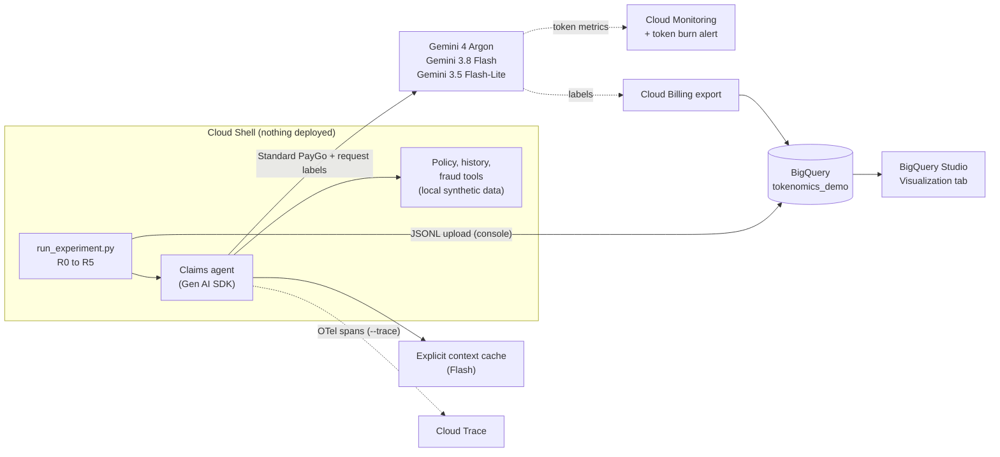

# 🧾 The Token Bill of Materials: AI Tokenomics on Google Cloud

[](https://github.com/Rajdipc/tokenomics-paygo-demo)
[](https://cloud.google.com/gemini-enterprise-agent-platform/generative-ai/pricing)
[](https://docs.cloud.google.com/gemini-enterprise-agent-platform/models/gemini/4-argon)
[](https://docs.cloud.google.com/gemini-enterprise-agent-platform/models/gemini/3-8-flash)
[](https://docs.cloud.google.com/gemini-enterprise-agent-platform/models/gemini/3-5-flash-lite)
[](https://docs.cloud.google.com/gemini-enterprise-agent-platform/models/standard-paygo)
[](https://docs.cloud.google.com/bigquery/docs/running-queries)
[](https://docs.cloud.google.com/gemini-enterprise-agent-platform/models/capabilities/add-labels-to-api-calls)
[](#-the-data-100-synthetic)
[](https://www.python.org/)
[](#-companion-blog-post)

`#AITokenomics` &nbsp;•&nbsp; `#Gemini` &nbsp;•&nbsp; `#GeminiPlatform` &nbsp;•&nbsp; `#FinOps` &nbsp;•&nbsp; `#AIAgents` &nbsp;•&nbsp; `#ContextCaching` &nbsp;•&nbsp; `#BigQuery` &nbsp;•&nbsp; `#CloudBilling` &nbsp;•&nbsp; `#CostPerOutcome` &nbsp;•&nbsp; `#Apigee` &nbsp;•&nbsp; `#GoogleCloud`

---

**What does one task of your AI agent cost, why does it cost that, and what happens to quality when you make it cheaper?**

This repo answers those questions for a realistic **insurance-claims agent on Gemini Platform** (formerly Vertex AI). The same claims go through the agent in **five designs**, one cost lever at a time. Every model call is itemized into a **Token Bill of Materials (TBOM)**:

- system prompt
- handbook
- tool schemas
- conversation history
- tool results
- the claim itself
- thinking
- output

Every decision is scored against an answer key, so you get **cost per *correctly resolved* claim**, not just cost per token.

> [!IMPORTANT]
> **One script, everything else in the Cloud Console.** You run [`run_experiment.py`](run_experiment.py) once from Cloud Shell. Loading results, building the charts, the budget, the token alert and the billing export are all console steps, described in [`RUNBOOK.md`](RUNBOOK.md). **Nothing is deployed**, and everything runs on **Standard pay-as-you-go** with **GA models only**.

**Contents**
| | |
| :--- | :--- |
| [🚀 Quickstart](#-quickstart) | [🗂️ Repository Structure](#%EF%B8%8F-repository-structure) |
| [🎯 How You Can Use This Repo](#-how-you-can-use-this-repo) | [🧪 The Five Designs](#-the-five-designs) |
| [🏗️ Architecture](#%EF%B8%8F-architecture) | [📊 What You Get in BigQuery](#-what-you-get-in-bigquery) |
| [🧬 The Data (100% Synthetic)](#-the-data-100-synthetic) | [✅ Verifying It Worked](#-verifying-it-worked) |
| [💸 Cost & Cleanup](#-cost--cleanup) | [⚠️ Assumptions & Honest Caveats](#%EF%B8%8F-assumptions--honest-caveats) |
| [📰 Companion Blog Post](#-companion-blog-post) | [📚 Official Documentation](#-official-documentation) |

---

## 🚀 Quickstart

**1. Open [Cloud Shell](https://shell.cloud.google.com) and clone:**

```bash
git clone https://github.com/Rajdipc/tokenomics-paygo-demo.git
cd tokenomics-paygo-demo
pip install -r requirements.txt
cp .env.example .env && nano .env      # set GOOGLE_CLOUD_PROJECT and TBOM_RUN_TAG
source .env
```

**2. Try it small first** (about 10 claims, a couple of dollars at list price):

```bash
python run_experiment.py --runs R0 R5 --n 10
```

**3. Run the full experiment:**

```bash
python run_experiment.py --runs R0 R1 R2 R3 R5 --n 50 --trace   # the cost waterfall
python run_experiment.py --runs R4U R4G --n 40 --trace          # loop guards vs a flaky dependency
```

**4. Analyze in the console:** upload `results/<run_tag>/*.jsonl` to BigQuery, paste the [`sql/`](sql/) files into BigQuery Studio and chart them in the **Visualization** tab. [`RUNBOOK.md`](RUNBOOK.md) walks through every click.

> [!TIP]
> Enable the Agent Platform API (`aiplatform.googleapis.com`) first. The script stops itself when its list-price estimate reaches `--max-usd` (default \$75).

---

## 🎯 How You Can Use This Repo

| If you are… | Use it to… | Start with |
| :--- | :--- | :--- |
| 💼 **A business leader or FinOps lead** | See which design decisions actually move cost per outcome, and what "good" AI cost governance looks like (labels → billing export → cost per outcome) | The [companion blog post](#-companion-blog-post), then [`v_cpo_by_run`](sql/04_cpo_by_run.sql) |
| 🏛️ **An architect** | Reuse the design patterns: model tiering with a confidence cascade, static-first prompts with context caching, loop guards, and choosing a consumption option | [The five designs](#-the-five-designs), [`v_lane_projection`](sql/05_lane_projection.sql), [`09_pt_what_if.sql`](sql/09_pt_what_if.sql) |
| 🛠️ **An engineer** | Reproduce the experiment end to end, then point the same TBOM ledger at **your own agent** | [Quickstart](#-quickstart), then [Adapting it to your agent](#adapting-it-to-your-own-agent) |
| 📊 **An analyst** | Reuse the BigQuery views on your own Gemini usage and billing export | [`sql/`](sql/) and the [`schemas`](sql/schemas/) |

### Adapting it to your own agent

The TBOM ledger is self-contained in [`run_experiment.py`](run_experiment.py):

1. **Record usage per call.** Copy `Agent.call()`. It reads `response.usage_metadata` (prompt, cached, thinking and output tokens) and writes one row per call.
2. **Allocate the prompt.** Copy `allocate()`. Pass it the character size of each part of the request you assembled (system prompt, documents, tool schemas, history, tool results, user input). It splits the billed prompt tokens so the parts sum exactly to the invoice.
3. **Label every request** using `Agent.labels()`. Keep keys low-cardinality (app, feature, step, tier). Labels reach Cloud Billing for PayGo traffic, and each key holds at most 1,000 unique values.
4. **Reuse the views.** Upload your rows with the same [`schemas`](sql/schemas/) and the views in [`sql/`](sql/) work unchanged.

---

## 🧪 The Five Designs

| Run | Playbook move | What changes | Model(s) |
| :--- | :--- | :--- | :--- |
| **R0** | Baseline | One agent does everything: 25 tools, verbose JSON tool output, handbook after every claim, 3 claims per chat, long justifications | Gemini 4 Argon |
| **R1** | ✂️ Trim the TBOM | 3 tools, compact tool output, fresh session per claim, short answers | Gemini 4 Argon |
| **R2** | 🪜 Tier the models | Triage → adjudicate → frontier review **only** below 0.8 confidence | 3.5 Flash-Lite → 3.8 Flash → 4 Argon |
| **R3** | 🧊 Cache the prefix | Static instructions + handbook first; **explicit** cache on Flash, **implicit** (durable) cache on Argon | same as R2 |
| **R4U / R4G** | 🛑 Guard the loop | Fraud service times out for 20% of claims, without and with a retry budget + 8-call ceiling | same as R2 |
| **R5** | 🚢 Production | R3 + guards on healthy dependencies | same as R2 |

Flex PayGo, Priority PayGo, Batch, Provisioned Throughput and Flexible Savings Plans are **not called**. Instead, [`v_lane_projection`](sql/05_lane_projection.sql) re-prices the measured tokens on each option, and [`09_pt_what_if.sql`](sql/09_pt_what_if.sql) sizes a hypothetical PT reservation.

---

## 🏗️ Architecture



> [!NOTE]
> **Apigee (optional, not run):** at fleet scale, an Apigee AI gateway in front of Gemini adds central token budgets ([LLMTokenQuota](https://docs.cloud.google.com/apigee/docs/api-platform/reference/policies/llm-token-quota-policy)), prompt-burst protection ([PromptTokenLimit](https://docs.cloud.google.com/apigee/docs/api-platform/reference/policies/prompt-token-limit-policy)), [semantic caching](https://docs.cloud.google.com/apigee/docs/api-platform/reference/policies/semantic-cache-lookup-policy) and per-consumer analytics for chargeback. See [RUNBOOK step 11](RUNBOOK.md#11-optional-put-apigee-in-front-not-part-of-the-default-run-deploys-a-gateway).

---

## 🗂️ Repository Structure

```text
.
├── run_experiment.py          # 🐍 the ONLY script: agent + TBOM ledger + runner (7 commented sections)
├── requirements.txt           # google-genai (+ optional OpenTelemetry for --trace)
├── .env.example               # GOOGLE_CLOUD_PROJECT, GOOGLE_CLOUD_LOCATION, TBOM_RUN_TAG
├── RUNBOOK.md                 # 🧭 step-by-step Cloud Console guide with screenshot slots
├── data/                      # 🧬 synthetic Cymbal Insurance data (see data/README.md)
│   ├── customers.csv          #     8,000 customers
│   ├── policies.csv           #    12,000 policies
│   ├── claims_history.csv     #    60,000 historical claims
│   ├── incoming_claims.jsonl  #     5,000 claim e-mails (what the agent reads)
│   ├── answer_key.csv         #     5,000 expected decisions
│   └── policy_handbook.md     #     ~20K-token claims handbook
└── sql/                       # 📊 paste into BigQuery Studio (see sql/README.md)
    ├── schemas/               #     table schemas for the console JSONL upload
    ├── 00_reference_tables.sql
    ├── 01 … 06_*.sql          #     views behind every chart
    ├── 07 … 08_*.sql          #     the real invoice by label (needs billing export)
    └── 09_pt_what_if.sql      #     Provisioned Throughput sizing what-if
```

---

## 📊 What You Get in BigQuery

| View | Question it answers | Suggested chart |
| :--- | :--- | :--- |
| `v_run_summary` | What does one claim cost in each design, and is it still right? | Bar (the waterfall) |
| `v_tbom_by_run` | Which line items make up each claim's bill? | Stacked bar |
| `v_token_variance` | How far does the 95th percentile drift from the median? | Bar (p50 vs p95) |
| `v_cpo_by_run` | What does a *correct* claim cost, once you include review and rework? | Stacked bar |
| `v_lane_projection` | What would the same tokens cost on Priority, Flex or Batch? | Grouped bar |
| `v_loop_guard` | What does a flaky dependency cost with and without guards? | Bar |
| `v_billing_by_label` | What did Cloud Billing *actually* charge, by run, step and tier? | Table / bar |
| `v_estimate_vs_invoice` | How far is the script's estimate from the invoice (promotions, cache storage)? | Bar |

---

## 🧬 The Data (100% Synthetic)

Every record is generated with a fixed seed, so every reader gets identical files. **Cymbal Insurance is fictional**, and there's no customer data anywhere. The dataset covers five products (car, home, renters, travel, pet), three plans, optional riders, claim e-mails in four writing styles, and a nine-step decision procedure in the handbook. The answer key is computed from the same rules, which is what makes accuracy measurable. The full data dictionary is in [`data/README.md`](data/README.md).

---

## ✅ Verifying It Worked

- [ ] The script prints one summary line per run, with accuracy, tokens per claim, cached share and \$ per claim.
- [ ] `results/<run_tag>/` contains `calls.jsonl`, `claims.jsonl` and `runs.jsonl`.
- [ ] In BigQuery, `SELECT run_id, COUNT(*) FROM tokenomics_demo.claims GROUP BY 1` returns one row per run.
- [ ] Trace explorer shows service `tbom-claims-demo` (if you used `--trace`).
- [ ] A few hours later, `v_billing_by_label` shows rows labelled `experiment = tbom`.

---

## 💸 Cost & Cleanup

| Item | Approximate cost |
| :--- | :--- |
| Default runs (R0–R3 + R5 on 50 claims, R4U/R4G on 40) | **≈ \$58 at regular list price**. Roughly half while the pricing page's promotional credits apply (Gemini 4 Argon to 30 Nov 2026, Gemini 3.8 Flash to 31 Dec 2026) |
| Explicit context caches | Cents. Deleted by the script at the end of each run |
| BigQuery storage and queries | Cents for this data volume |
| Cloud Trace / Monitoring | Usually within free allotments |

**Cleanup:** delete the `tokenomics_demo` dataset, the alert policy and the budget. See [RUNBOOK step 12](RUNBOOK.md#12-clean-up).

---

## ⚠️ Assumptions & Honest Caveats

- **Prices are list prices as of 15 Oct 2026**, from the [pricing page](https://cloud.google.com/gemini-enterprise-agent-platform/generative-ai/pricing). Re-check them before you rely on the numbers. Cloud Billing is the source of truth, and `v_estimate_vs_invoice` shows any gap.
- **The TBOM split is an allocation.** Totals per call are measured by the API; the per-component split is proportional to the size of each part, scaled to the billed total.
- **Synthetic data is cleaner than real life.** The handbook and answer key agree perfectly, so treat accuracy as closer to an upper bound. The *shape* of the bill of materials carries over better than the exact numbers.
- **Other consumption options are projections**, not measurements. Their latency and throttling aren't modelled. Gemini 4 Argon doesn't offer Flex PayGo; those calls stay at Standard price in the projection.
- **The cost-per-outcome unit costs** (tool call, human review, rework) are illustrative. Edit them in [`sql/00_reference_tables.sql`](sql/00_reference_tables.sql).

---

## 📰 Companion Blog Post

📝 **The Token Bill of Materials: A Measured Guide to AI Tokenomics on Google Cloud** (Google Cloud Community on Medium, *link coming soon*). It covers the business problem, the economics (four meters, five layers, the Apigee gateway, hidden costs, cost per outcome), and walks through the results of this repo.

---

## 📚 Official Documentation

- [Generative AI pricing (Gemini Platform)](https://cloud.google.com/gemini-enterprise-agent-platform/generative-ai/pricing) · [Consumption options](https://docs.cloud.google.com/gemini-enterprise-agent-platform/models/deploy/consumption-options) · [Flexible Savings Plans](https://docs.cloud.google.com/docs/cuds-flexible-savings-plans)
- [Context caching](https://docs.cloud.google.com/gemini-enterprise-agent-platform/models/context-cache/context-cache-overview) · [Zero data retention](https://docs.cloud.google.com/gemini-enterprise-agent-platform/resources/zero-data-retention)
- [Request labels for cost](https://docs.cloud.google.com/gemini-enterprise-agent-platform/models/capabilities/add-labels-to-api-calls) · [Billing export to BigQuery](https://docs.cloud.google.com/billing/docs/how-to/export-data-bigquery) · [Budgets](https://docs.cloud.google.com/billing/docs/how-to/budgets)
- [Model observability](https://docs.cloud.google.com/gemini-enterprise-agent-platform/models/model-observability) · [Cloud Trace](https://docs.cloud.google.com/trace/docs/finding-traces) · [Alerting](https://docs.cloud.google.com/monitoring/alerts)
- [BigQuery: run a query (Visualization tab)](https://docs.cloud.google.com/bigquery/docs/running-queries) · [BigQuery data canvas](https://docs.cloud.google.com/bigquery/docs/data-canvas)
- [Apigee pricing](https://cloud.google.com/apigee/pricing)

<sub>Views expressed are my own. Cymbal Insurance is a fictional company used for demonstration.</sub>
