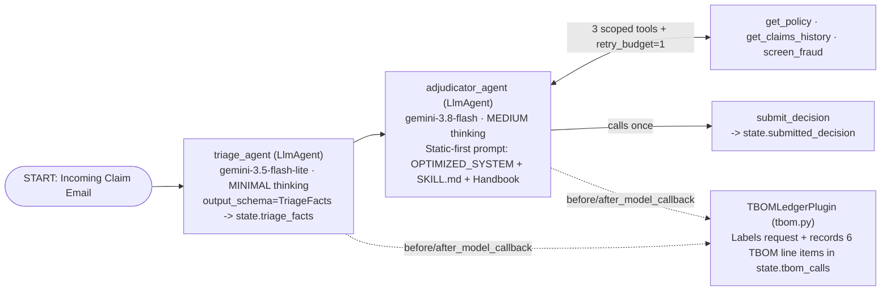
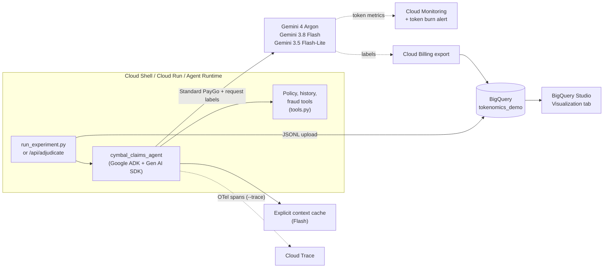

# 🧾 The Token Bill of Materials: AI Tokenomics on Google Cloud

[](https://github.com/Rajdipc/tokenomics-paygo-demo)
[](https://google.github.io/adk-docs/)
[](https://cloud.google.com/gemini-enterprise-agent-platform/generative-ai/pricing)
[](#-step-by-step-agent-deployment-cloud-run--agent-runtime)
[](https://docs.cloud.google.com/gemini-enterprise-agent-platform/models/gemini/4-argon)
[](https://docs.cloud.google.com/gemini-enterprise-agent-platform/models/gemini/3-8-flash)
[](https://docs.cloud.google.com/gemini-enterprise-agent-platform/models/gemini/3-5-flash-lite)
[](https://docs.cloud.google.com/gemini-enterprise-agent-platform/models/standard-paygo)
[](https://docs.cloud.google.com/bigquery/docs/running-queries)
[](https://docs.cloud.google.com/gemini-enterprise-agent-platform/models/capabilities/add-labels-to-api-calls)
[](#-the-data-100-synthetic)
[](https://www.python.org/)
[]([#-companion-blog-post](https://medium.com/@rajdipch/81f6203fcbbc))

`#AITokenomics` &nbsp;•&nbsp; `#GoogleADK` &nbsp;•&nbsp; `#Gemini` &nbsp;•&nbsp; `#GeminiPlatform` &nbsp;•&nbsp; `#AgentRuntime` &nbsp;•&nbsp; `#CloudRun` &nbsp;•&nbsp; `#FinOps` &nbsp;•&nbsp; `#AIAgents` &nbsp;•&nbsp; `#ContextCaching` &nbsp;•&nbsp; `#BigQuery` &nbsp;•&nbsp; `#CloudBilling` &nbsp;•&nbsp; `#CostPerOutcome`

---

**What does one task of your AI agent cost, why does it cost that, and what happens to quality when you make it cheaper?**

This repository builds a production **insurance-claims agent on Gemini Platform** (formerly Vertex AI) using **Google ADK 2.x** ([`cymbal_claims_agent/`](cymbal_claims_agent/)), deploys it to **Cloud Run** and **Gemini Platform Agent Runtime (Agent Engine)** ([`deploy/`](deploy/)), and benchmarks the same claims across **five architectural designs** ([`run_experiment.py`](run_experiment.py)), applying one cost lever at a time. Every model call is itemized into a **Token Bill of Materials (TBOM)**:

- system prompt
- handbook
- tool schemas
- conversation history
- tool results
- the claim itself
- thinking
- output

Every decision is scored against a deterministic answer key, so you measure **cost per *correctly resolved* claim (`CpO`)**, not just cost per token.

**Contents**
| | |
| :--- | :--- |
| [🚀 Quickstart](#-quickstart) | [🗂️ Repository Structure](#%EF%B8%8F-repository-structure) |
| [🧠 Code Flow: How the Agent is Created](#-code-flow-how-the-agent-is-created-cymbal_claims_agent) | [🚢 Step-by-Step Agent Deployment (Cloud Run & Agent Runtime)](#-step-by-step-agent-deployment-cloud-run--agent-runtime) |
| [🎯 How You Can Use This Repo](#-how-you-can-use-this-repo) | [🧪 The Five Designs (`R0` to `R5`)](#-the-five-designs) |
| [🏗️ Architecture](#%EF%B8%8F-architecture) | [📊 What You Get in BigQuery](#-what-you-get-in-bigquery) |
| [🧬 The Data (100% Synthetic)](#-the-data-100-synthetic) | [✅ Verifying It Worked](#-verifying-it-worked) |
| [💸 Cost & How to Destroy This Deployment](#-cost--how-to-destroy-this-deployment-complete-teardown) | [⚠️ Assumptions & Honest Caveats](#%EF%B8%8F-assumptions--honest-caveats) |
| [📰 Companion Blog Post](#-companion-blog-post) | [📚 Official Documentation](#-official-documentation) |

---

## 🚀 Quickstart

**1. Open [Cloud Shell](https://shell.cloud.google.com) and clone:**

```bash
git clone https://github.com/Rajdipc/tokenomics-paygo-demo.git
cd tokenomics-paygo-demo
pip install -U -r requirements.txt
cp .env.example .env && nano .env      # set GOOGLE_CLOUD_PROJECT and TBOM_RUN_TAG (no project IDs are hardcoded)
source deploy/00_variables.sh
```

**2. Smoke-test the Google ADK agent on a single claim** (prints the claim decision + itemized TBOM receipt):

```bash
python deploy/05_test_deployed_agent.py --claim-ref CLM-000001
```

**3. Run the 5-design TBOM waterfall experiment** (start small with `--n 10`, or run the full 50-claim benchmark):

```bash
python run_experiment.py --runs R0 R5 --n 10                    # quick smoke run (~$2 at list price)
python run_experiment.py --runs R0 R1 R2 R3 R5 --n 50 --trace   # the full cost waterfall
python run_experiment.py --runs R4U R4G --n 40 --trace          # loop guards vs a flaky dependency
```

**4. Deploy the production `R5` agent to Cloud Run or Gemini Platform Agent Runtime:**

```bash
bash deploy/01_enable_apis.sh
bash deploy/02_service_account_iam.sh
bash deploy/03_deploy_cloud_run.sh             # deploys private Cloud Run service
python deploy/04_deploy_agent_runtime.py       # deploys managed Agent Runtime (ReasoningEngine)
```

**5. Analyze in BigQuery:** upload `results/<run_tag>/*.jsonl` to BigQuery, paste the [`sql/`](sql/) files into BigQuery Studio, and chart them in the **Visualization** tab. [`RUNBOOK.md`](RUNBOOK.md) walks through every step.

---

## 🧠 Code Flow: How the Agent is Created (`cymbal_claims_agent/`)

The production **R5** agent is built in [`cymbal_claims_agent/`](cymbal_claims_agent/) using **Google ADK 2.x** (`Workflow`, `LlmAgent`, `FunctionTool`, and `BasePlugin`).

### 1. The ADK 2.x Workflow Graph (`cymbal_claims_agent/agent.py`)

Defined in [`cymbal_claims_agent/agent.py`](cymbal_claims_agent/agent.py) (`build_production_adk_agent()`):



- **`create_triage_agent()`** ([`cymbal_claims_agent/agent.py`](cymbal_claims_agent/agent.py)): Creates the first `LlmAgent` on **`gemini-3.5-flash-lite`** with `thinking_level="MINIMAL"` and `output_schema=TriageFacts`. It extracts `policy_id`, `incident_date`, `filed_date`, `peril`, `amount_claimed`, `complexity`, and `summary` into `session.state["triage_facts"]`.
- **`create_adjudicator_agent()`** ([`cymbal_claims_agent/agent.py`](cymbal_claims_agent/agent.py)): Creates the second `LlmAgent` on **`gemini-3.8-flash`** with `thinking_level="MEDIUM"`. Its instruction provider (`_adk_adjudicator_instruction`) places the static instructions, the [`skills/cymbal-claims-adjudication/SKILL.md`](skills/cymbal-claims-adjudication/SKILL.md) workflow, and the 20,000-token `<handbook>` **first** so context caching reuses the prefix across claims, and equips the agent with **only the 3 domain tools** (`get_policy`, `get_claims_history`, `screen_fraud`) plus `submit_decision`.
- **`create_reviewer_agent()`** ([`cymbal_claims_agent/agent.py`](cymbal_claims_agent/agent.py)): Creates the senior reviewer `LlmAgent` on **`gemini-4-argon`** with `thinking_level="HIGH"` for low-confidence escalations (`< 0.80`).
- **`build_production_adk_agent()` & `app`**: Wires the nodes into an ADK 2.x `Workflow` (`root_agent`) and wraps it in `App(name="cymbal_claims_agent", root_agent=root_agent, plugins=[TBOMLedgerPlugin(run_id="R5")])`.

### 2. Scoped Tools, ID Normalization & Circuit Breaker (`cymbal_claims_agent/tools.py`)

Defined in [`cymbal_claims_agent/tools.py`](cymbal_claims_agent/tools.py):

| Function / Class | Role | Tokenomics Principle Enforced |
| :--- | :--- | :--- |
| `get_policy(policy_id, tool_context)` | Returns a compact 1-row Markdown table with the 9 fields used by the handbook rules (instead of R0's verbose 12-month billing JSON) | **Context hygiene:** shrinks tool-result tokens by ~85% |
| `Tools.norm_policy_id(raw)` | Normalizes casual 6-digit strings (`"policy no. 003009"` → `"POL-003009"`) deterministically in Python | **`AGENTS.md` Rule #3:** shifts deterministic formatting out of the LLM loop and prevents \$18 human rework from `POLICY_NOT_FOUND` errors |
| `get_claims_history(customer_id, as_of_date, lookback_days, tool_context)` | Counts prior claims in the 365-day window before the incident date | **Compact tool output:** returns the exact count and up to 3 lines |
| `screen_fraud(policy_id, peril, amount_claimed, tool_context)` | Returns advisory fraud score (`1–95`), or enforces `retry_budget=1` when upstream timeouts occur (`R4G`) | **`AGENTS.md` Rule #4:** circuit breaker trips on the 2nd timeout (`retryable=False`) and directs the agent to Handbook Step 6 (`SCREENING_UNAVAILABLE`) |
| `submit_decision(...)` | Records the final decision (`APPROVE`, `DENY`, `ESCALATE`), payout, reason code, and ≤40-word justification into `session.state["submitted_decision"]` | **Structured termination:** stops the adjudication loop as soon as a decision is reached |

### 3. Real-Time Token Bill of Materials Plugin (`cymbal_claims_agent/tbom.py`)

Defined in [`cymbal_claims_agent/tbom.py`](cymbal_claims_agent/tbom.py):

- **`TBOMLedgerPlugin`** (`BasePlugin`):
  - **`before_model_callback`**: Attaches low-cardinality Cloud Billing labels (`app=cymbal-claims`, `experiment=tbom`, `run=r5`, `run_tag=<tag>`, `step=triage|adjudicator`, `tier=flash-lite|flash|frontier`) to `llm_request.config.labels` and measures the character length of the six prompt components (`system_prompt`, `handbook`, `tool_schemas`, `history`, `tool_results`, `claim_input`).
  - **`after_model_callback`**: Reads `llm_response.usage_metadata` (`prompt_token_count`, `cached_content_token_count`, `candidates_token_count`, `thoughts_token_count`), computes list-price USD cost via `token_cost()`, allocates `prompt_token_count` across the six TBOM line items via `allocate()`, and appends the row to `session.state["tbom_calls"]`.

### 4. FastAPI & Agent Runtime Serving Surface (`cymbal_claims_agent/fast_api_app.py`)

Defined in [`cymbal_claims_agent/fast_api_app.py`](cymbal_claims_agent/fast_api_app.py):

- **`GET /api/health`**: Returns readiness status, loaded `SKILL.md`, active GA models (`gemini-3.5-flash-lite`, `gemini-3.8-flash`, `gemini-4-argon`), and the 4 registered tools.
- **`POST /api/adjudicate`**: Accepts `{"claim_ref": "CLM-000001", "inject_faults": false}` (or raw `claim_text`), runs the ADK `Runner`, checks accuracy against `answer_key.csv`, and returns the decision **plus the full itemized TBOM receipt** (`tbom_summary` and per-call `calls`).
- **ADK & Agent Runtime Routes**: Exposes standard ADK endpoints (`/run`, `/run_sse`, `/apps/cymbal_claims_agent/...`), the ADK Developer Web UI (`/`), and the Gemini Platform Agent Runtime (`reasoning_engine`) contract routes (`POST /api/reasoning_engine` and `POST /api/stream_reasoning_engine`).

---

## 🚢 Step-by-Step Agent Deployment (Cloud Run & Agent Runtime)

All deployment scripts live in [`deploy/`](deploy/) and read your project settings dynamically from `.env` (or `gcloud config get-value project`). **No project IDs are hardcoded anywhere.**

### Step 1: Configure `.env` and enable APIs

```bash
cp .env.example .env
# Edit .env to set GOOGLE_CLOUD_PROJECT="your-project-id"
source deploy/00_variables.sh

# Enable Agent Platform, Cloud Run, Cloud Build, Artifact Registry, BigQuery, Monitoring & Trace APIs
bash deploy/01_enable_apis.sh

# Create the least-privilege runtime service account (cymbal-claims-agent-sa)
bash deploy/02_service_account_iam.sh
```

### Step 2A: Deploy to Cloud Run (Containerized FastAPI + ADK Web Server)

[`deploy/03_deploy_cloud_run.sh`](deploy/03_deploy_cloud_run.sh) builds the [`Dockerfile`](Dockerfile) container image via Cloud Build into Artifact Registry and deploys `cymbal-claims-tbom-agent` to Cloud Run with `--no-allow-unauthenticated` and `--min-instances=0` (scales to zero when idle):

```bash
bash deploy/03_deploy_cloud_run.sh
```

Test the deployed Cloud Run service (authenticates automatically with `gcloud auth print-identity-token`):

```bash
SERVICE_URL="$(gcloud run services describe "$CLOUD_RUN_SERVICE" \
  --region="$DEPLOY_REGION" --project="$PROJECT_ID" --format='value(status.url)')"

python deploy/05_test_deployed_agent.py \
  --cloud-run-url "$SERVICE_URL" \
  --claim-ref CLM-000001
```

### Step 2B: Deploy to Gemini Platform Agent Runtime (Vertex AI Agent Engine)

[`deploy/04_deploy_agent_runtime.py`](deploy/04_deploy_agent_runtime.py) packages `cymbal_claims_agent`, `data/`, and `skills/` into an `AdkApp` and deploys it to **Gemini Platform Agent Runtime** (`vertexai.agent_engines.create`), saving the deployed resource name to `deployment_metadata.json`:

```bash
python deploy/04_deploy_agent_runtime.py
```

Query the deployed Agent Runtime instance:

```bash
python deploy/05_test_deployed_agent.py \
  --agent-runtime-id auto \
  --claim-ref CLM-000001
```

---

## 🎯 How You Can Use This Repo

| If you are… | Use it to… | Start with |
| :--- | :--- | :--- |
| 💼 **A business leader or FinOps lead** | See which design decisions actually move cost per outcome, and what "good" AI cost governance looks like (labels → billing export → cost per outcome) | The [companion blog post](#-companion-blog-post), then [`v_cpo_by_run`](sql/04_cpo_by_run.sql) |
| 🏛️ **An architect** | Reuse the design patterns: model tiering with a confidence cascade, static-first prompts with context caching, loop guards, and choosing a consumption option | [The five designs](#-the-five-designs), [`v_lane_projection`](sql/05_lane_projection.sql), [`09_pt_what_if.sql`](sql/09_pt_what_if.sql) |
| 🛠️ **An engineer** | Deploy the ADK agent to Cloud Run or Agent Runtime, reproduce the 5-design experiment, then point the same TBOM plugin at **your own agent** | [Code Flow](#-code-flow-how-the-agent-is-created-cymbal_claims_agent), [Deployment](#-step-by-step-agent-deployment-cloud-run--agent-runtime), then [Adapting it to your agent](#adapting-it-to-your-own-agent) |
| 📊 **An analyst** | Reuse the BigQuery views on your own Gemini usage and billing export | [`sql/`](sql/) and the [`schemas`](sql/schemas/) |

### Adapting it to your own agent

The TBOM ledger is modular in [`cymbal_claims_agent/tbom.py`](cymbal_claims_agent/tbom.py):

1. **Drop `TBOMLedgerPlugin` into any Google ADK `App`:**
   ```python
   from google.adk.apps import App
   from cymbal_claims_agent.tbom import TBOMLedgerPlugin

   app = App(name="my_agent", root_agent=root_agent, plugins=[TBOMLedgerPlugin(run_id="prod")])
   ```
2. **Or copy `allocate()` and `token_cost()`** into any custom `google-genai` harness. Pass `allocate()` the character size of each part of the request you assembled (system prompt, documents, tool schemas, history, tool results, user input). It splits the billed prompt tokens so the parts sum *exactly* to the invoice.
3. **Label every request** using `build_labels()`. Keep keys low-cardinality (`app`, `experiment`, `run`, `step`, `tier`). Labels reach Cloud Billing for PayGo traffic, and each key holds at most 1,000 unique values.
4. **Reuse the views.** Upload your rows with the same [`schemas`](sql/schemas/) and the views in [`sql/`](sql/) work unchanged.
5. **Package domain procedures as Skills (`SKILL.md`) and persistent rules (`AGENTS.md`).** See [`skills/cymbal-claims-adjudication/SKILL.md`](skills/cymbal-claims-adjudication/SKILL.md) and [`AGENTS.md`](AGENTS.md).

---

## 🧪 The Five Designs

| Run | Playbook move | What changes | Model(s) |
| :--- | :--- | :--- | :--- |
| **R0** | Baseline | One agent does everything: 25 tools, verbose JSON tool output, handbook after every claim, 3 claims per chat, long justifications | Gemini 4 Argon |
| **R1** | ✂️ Trim the TBOM | 3 tools, compact tool output, fresh session per claim, short answers | Gemini 4 Argon |
| **R2** | 🪜 Tier the models | Triage → adjudicate → frontier review **only** below 0.8 confidence | 3.5 Flash-Lite → 3.8 Flash → 4 Argon |
| **R3** | 🧊 Cache the prefix | Static instructions + handbook first; **explicit** cache on Flash, **implicit** (durable) cache on Argon | same as R2 |
| **R4U / R4G** | 🛑 Guard the loop | Starting from R3: the fraud service times out for 20% of claims, without and with a retry budget + 8-call ceiling | same as R2 |
| **R5** | 🚢 Production | R3 + guards on healthy dependencies (the architecture deployed by `cymbal_claims_agent/`) | same as R2 |

Flex PayGo, Priority PayGo, Batch, Provisioned Throughput and Flexible Savings Plans are **not called**. Instead, [`v_lane_projection`](sql/05_lane_projection.sql) re-prices the measured tokens on each option, and [`09_pt_what_if.sql`](sql/09_pt_what_if.sql) sizes a hypothetical PT reservation.

---

## 🏗️ Architecture



> [!NOTE]
> **Apigee (optional, not run):** at fleet scale, an Apigee AI gateway in front of Gemini adds central token budgets ([LLMTokenQuota](https://docs.cloud.google.com/apigee/docs/api-platform/reference/policies/llm-token-quota-policy)), prompt-burst protection ([PromptTokenLimit](https://docs.cloud.google.com/apigee/docs/api-platform/reference/policies/prompt-token-limit-policy)), [semantic caching](https://docs.cloud.google.com/apigee/docs/api-platform/reference/policies/semantic-cache-lookup-policy) and per-consumer analytics for chargeback. See [RUNBOOK step 11](RUNBOOK.md#11-optional-put-apigee-in-front-not-part-of-the-default-run-deploys-a-gateway).

---

## 🗂️ Repository Structure

```text
.
├── cymbal_claims_agent/               # 🧠 Core Agent Package (Google ADK 2.x + TBOM Ledger + FastAPI)
│   ├── __init__.py                    #     Exports `app`, `root_agent`, `TBOMLedgerPlugin`, `Store`, `Tools`
│   ├── agent.py                       #     ADK 2.x `Workflow` (`triage_agent` -> `adjudicator_agent`) + experiment harness
│   ├── tools.py                       #     `Store`, `Tools` (`norm_policy_id`, `retry_budget=1`), and ADK `FunctionTool`s
│   ├── tbom.py                        #     `PRICES`, `token_cost()`, `allocate()`, and `TBOMLedgerPlugin` callbacks
│   └── fast_api_app.py                #     FastAPI server (`/api/health`, `/api/adjudicate`, ADK & Agent Runtime routes)
├── deploy/                            # 🚀 Step-by-step Cloud Shell deployment & teardown scripts
│   ├── 00_variables.sh                #     Loads and validates `.env` variables (no hardcoded project IDs)
│   ├── 01_enable_apis.sh              #     Enables Agent Platform, Cloud Run, Cloud Build, Artifact Registry, BigQuery, etc.
│   ├── 02_service_account_iam.sh      #     Creates least-privilege runtime SA (`cymbal-claims-agent-sa`)
│   ├── 03_deploy_cloud_run.sh         #     Builds container via Cloud Build and deploys to Cloud Run
│   ├── 04_deploy_agent_runtime.py     #     Deploys ADK agent to Gemini Platform Agent Runtime (Agent Engine)
│   ├── 05_test_deployed_agent.py      #     Smoke-tests local ADK runner, Cloud Run `/api/adjudicate`, or Agent Runtime
│   └── 99_destroy.sh                  #     One-command teardown of all deployed & experiment resources
├── Dockerfile                         # 🐳 Production container image (Python 3.12, non-root, port 8080)
├── .dockerignore                      #     Excludes `.git`, `results/`, `.venv/` from Cloud Build context
├── run_experiment.py                  # 🔬 5-design TBOM waterfall & loop-guard experiment runner (`R0`..`R5`, `R4U`/`R4G`)
├── AGENTS.md                          # 📏 Persistent workspace rules (Principle 9: fix rules, don't re-prompt)
├── skills/                            # 🧩 Reusable agent skill (Principle 2: progressive disclosure)
│   └── cymbal-claims-adjudication/
│       └── SKILL.md                   #     ~35-token header; loads the 9-step procedure on demand
├── requirements.txt                   #     google-genai, google-adk, google-cloud-aiplatform, fastapi, uvicorn, OTel
├── .env.example                       #     Template for project, region, run tag, and deployment settings
├── RUNBOOK.md                         # 🧭 Step-by-step Cloud Console & Cloud Shell guide with screenshot slots
├── data/                              # 🧬 Synthetic Cymbal Insurance data (see data/README.md)
│   ├── customers.csv                  #     8,000 customers
│   ├── policies.csv                   #    12,000 policies
│   ├── claims_history.csv             #    60,000 historical claims
│   ├── incoming_claims.jsonl          #     5,000 claim e-mails (what the agent reads)
│   ├── answer_key.csv                 #     5,000 expected decisions
│   └── policy_handbook.md             #     ~20K-token claims handbook
└── sql/                               # 📊 Paste into BigQuery Studio (see sql/README.md)
    ├── schemas/                       #     Table schemas for the console JSONL upload
    ├── 00_reference_tables.sql
    ├── 01 … 06_*.sql                  #     Views behind every chart
    ├── 07 … 08_*.sql                  #     The real invoice by label (needs billing export)
    └── 09_pt_what_if.sql              #     Provisioned Throughput sizing what-if
```

---

## 📊 What You Get in BigQuery

| View | Question it answers | Suggested chart |
| :--- | :--- | :--- |
| `v_run_summary` | What does one claim cost in each design, and is it still right? | Bar (the waterfall) |
| `v_tbom_by_run` | Which line items make up each claim's bill? | Stacked bar |
| `v_token_variance` | How far does the 95th percentile drift from the median? | Bar (p50 vs p95) |
| `v_cpo_by_run` | What does a *correct* claim cost, once you include review and rework? | Stacked bar |
| `v_lane_projection` | What would the same tokens cost on Priority, Flex or Batch? | Grouped bar |
| `v_loop_guard` | What does a flaky dependency cost with and without guards? | Bar |
| `v_billing_by_label` | What did Cloud Billing *actually* charge, by run, step and tier? | Table / bar |
| `v_estimate_vs_invoice` | How far is the script's estimate from the invoice (promotions, cache storage)? | Bar |

---

## 🧬 The Data (100% Synthetic)

Every record is generated with a fixed seed, so every reader gets identical files. **Cymbal Insurance is fictional**, and there's no customer data anywhere. The dataset covers five products (car, home, renters, travel, pet), three plans, optional riders, claim e-mails in four writing styles, and a nine-step decision procedure in the handbook. The answer key is computed from the same rules, which is what makes accuracy measurable. The full data dictionary is in [`data/README.md`](data/README.md).

---

## ✅ Verifying It Worked

- [ ] `python deploy/05_test_deployed_agent.py --claim-ref CLM-000001` returns `"correct": true` (`ESCALATE`, `ABOVE_AUTHORITY`, `payout_usd: 86176.66`) along with a 5-call `tbom_summary`.
- [ ] If deployed to Cloud Run, `GET /api/health` returns `"ok": true`, `"skill_loaded": true`, and `POST /api/adjudicate` returns the decision and itemized TBOM receipt.
- [ ] If deployed to Gemini Platform Agent Runtime, `deployment_metadata.json` contains your `reasoningEngines` resource ID and `deploy/05_test_deployed_agent.py --agent-runtime-id auto` streams the adjudication events.
- [ ] `run_experiment.py` prints one summary line per run, with accuracy, tokens per claim, cached share and \$ per claim, and writes `calls.jsonl`, `claims.jsonl` and `runs.jsonl` under `results/<run_tag>/`.
- [ ] In BigQuery, `SELECT run_id, COUNT(*) FROM tokenomics_demo.claims GROUP BY 1` returns one row per run.
- [ ] Trace explorer shows service `tbom-claims-demo` (if you used `--trace`).
- [ ] A few hours later, `v_billing_by_label` shows rows labelled `experiment = tbom`.

---

## 💸 Cost & How to Destroy This Deployment (Complete Teardown)

| Item | Approximate cost |
| :--- | :--- |
| Default runs (R0–R3 + R5 on 50 claims, R4U/R4G on 40) | **≈ \$25–\$30 at regular list price**; leave headroom as model behaviour varies run to run. Roughly half while the pricing page's promotional credits apply (Gemini 4 Argon to 30 Nov 2026, Gemini 3.8 Flash to 31 Dec 2026) |
| Cloud Run (`cymbal-claims-tbom-agent`) | Deployed with `--min-instances=0` (scales to zero when idle; billed only during active requests) |
| Gemini Platform Agent Runtime (`ReasoningEngine`) | Managed runtime; delete with `bash deploy/99_destroy.sh` when done testing |
| Explicit context caches | Cents. Automatically deleted by `run_experiment.py` at the end of each run (and 1-hour TTL) |
| BigQuery storage and queries | Cents for this data volume |

To completely remove every resource created during the walkthrough:

### Option A — One-Command Teardown Script (`deploy/99_destroy.sh`)

```bash
bash deploy/99_destroy.sh
```

`deploy/99_destroy.sh` automatically deletes:
1. The **Cloud Run** service (`cymbal-claims-tbom-agent`)
2. The **Gemini Platform Agent Runtime** (`ReasoningEngine`) instance recorded in `deployment_metadata.json`
3. The **Artifact Registry** repository (`cymbal-claims-tbom`)
4. Any leftover explicit **Gemini context caches** (`tbom-*`)
5. The **Cloud Monitoring** token-burn rate alert policy (`TBOM demo - Gemini token burn rate`)
6. The **BigQuery** dataset (`tokenomics_demo`)
7. The runtime **Service Account** (`cymbal-claims-agent-sa`)

### Option B — Cloud Console UI Teardown

1. **Cloud Run:** Console → **Cloud Run** → select `cymbal-claims-tbom-agent` → **Delete**.
2. **Agent Runtime (Agent Engine):** Console → **Agent Platform → Agent Engine** → select `cymbal-claims-tbom-agent` → **Delete**.
3. **Artifact Registry:** Console → **Artifact Registry → Repositories** → select `cymbal-claims-tbom` → **Delete**.
4. **BigQuery dataset:** Console → **BigQuery** → Explorer → click `⋮` next to `tokenomics_demo` → **Delete** → type `delete` → **Delete**.
5. **Token-burn alert policy & notification channel:** Console → **Monitoring → Alerting → Policies** → click `⋮` on `TBOM demo - Gemini token burn rate` → **Delete**.
6. **Budget:** Console → **Billing → Budgets & alerts** → select your demo budget → **Delete**.

See [RUNBOOK step 12](RUNBOOK.md#12-clean-up--destroy-this-deployment) for full details.

---

## ⚠️ Assumptions & Honest Caveats

- **Prices are list prices as of 15 Oct 2026**, from the [pricing page](https://cloud.google.com/gemini-enterprise-agent-platform/generative-ai/pricing). Re-check them before you rely on the numbers. Cloud Billing is the source of truth, and `v_estimate_vs_invoice` shows any gap.
- **The TBOM split is an allocation.** Totals per call are measured by the API; the per-component split is proportional to the size of each part, scaled to the billed total.
- **Synthetic data is cleaner than real life.** The handbook and answer key agree perfectly, so treat accuracy as closer to an upper bound. The *shape* of the bill of materials carries over better than the exact numbers.
- **Other consumption options are projections**, not measurements. Their latency and throttling aren't modelled. Gemini 4 Argon doesn't offer Flex PayGo; those calls stay at Standard price in the projection.
- **The cost-per-outcome unit costs** (tool call, human review, rework) are illustrative. Edit them in [`sql/00_reference_tables.sql`](sql/00_reference_tables.sql).
- **Lessons exposed while building the harness:**
  - **Self-reported confidence is a weak routing signal:** Gemini 3.8 Flash reported confidence `1.0` on every claim in `R2`, so the senior-review cascade never fired. Route cascades on observable signals (claim complexity, dollar amount, or disagreement between two fast passes).
  - **Normalize identifiers in code, not prompts:** Casual customer e-mails write `"policy no. 003009"` instead of `"POL-003009"`. Normalizing inside `Tools.norm_policy_id()` prevents avoidable `POLICY_NOT_FOUND` misses that otherwise trigger \$18 of human rework.
  - **Never let a prompt contradict a loop guard:** If a prompt says *"always obtain a successful screening score"* while the tool guard says *"do not retry,"* the model can burn tens of thousands of thinking tokens trying to reconcile the contradiction. Fix the prompt alongside the guard (`AGENTS.md` rule #4).

---

## 📰 Companion Blog Post

📝 **The Token Bill of Materials: A Measured Guide to AI Tokenomics on Google Cloud** (Google Cloud Community on Medium, *link coming soon*). It covers the business problem, the economics (four meters, five layers, the Apigee gateway, hidden costs, cost per outcome), and walks through the results of this repo.

---

## 📚 Official Documentation

- [Generative AI pricing (Gemini Platform)](https://cloud.google.com/gemini-enterprise-agent-platform/generative-ai/pricing) · [Consumption options](https://docs.cloud.google.com/gemini-enterprise-agent-platform/models/deploy/consumption-options) · [Flexible Savings Plans](https://docs.cloud.google.com/docs/cuds-flexible-savings-plans)
- [Google Agent Development Kit (ADK)](https://google.github.io/adk-docs/) · [Gemini Platform Agent Runtime (Agent Engine)](https://cloud.google.com/vertex-ai/generative-ai/docs/agent-engine/overview)
- [Context caching](https://docs.cloud.google.com/gemini-enterprise-agent-platform/models/context-cache/context-cache-overview) · [Zero data retention](https://docs.cloud.google.com/gemini-enterprise-agent-platform/resources/zero-data-retention)
- [Request labels for cost](https://docs.cloud.google.com/gemini-enterprise-agent-platform/models/capabilities/add-labels-to-api-calls) · [Billing export to BigQuery](https://docs.cloud.google.com/billing/docs/how-to/export-data-bigquery) · [Budgets](https://docs.cloud.google.com/billing/docs/how-to/budgets)
- [Model observability](https://docs.cloud.google.com/gemini-enterprise-agent-platform/models/model-observability) · [Cloud Trace](https://docs.cloud.google.com/trace/docs/finding-traces) · [Alerting](https://docs.cloud.google.com/monitoring/alerts)
- [BigQuery: run a query (Visualization tab)](https://docs.cloud.google.com/bigquery/docs/running-queries) · [BigQuery data canvas](https://docs.cloud.google.com/bigquery/docs/data-canvas)
- [Apigee pricing](https://cloud.google.com/apigee/pricing)

<sub>Views expressed are my own. Cymbal Insurance is a fictional company used for demonstration.</sub>
