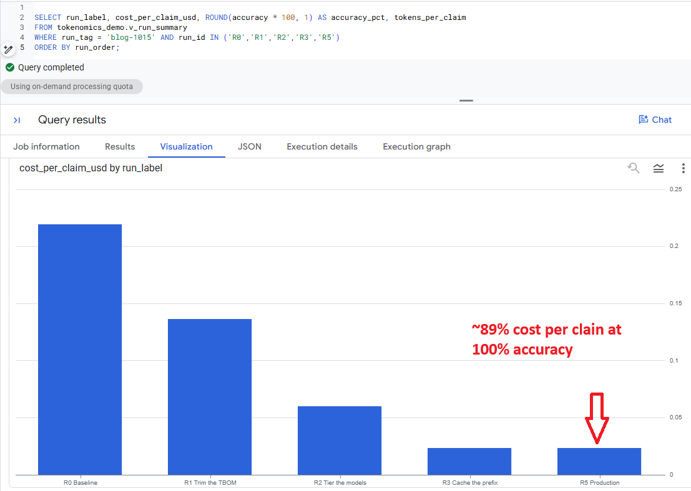
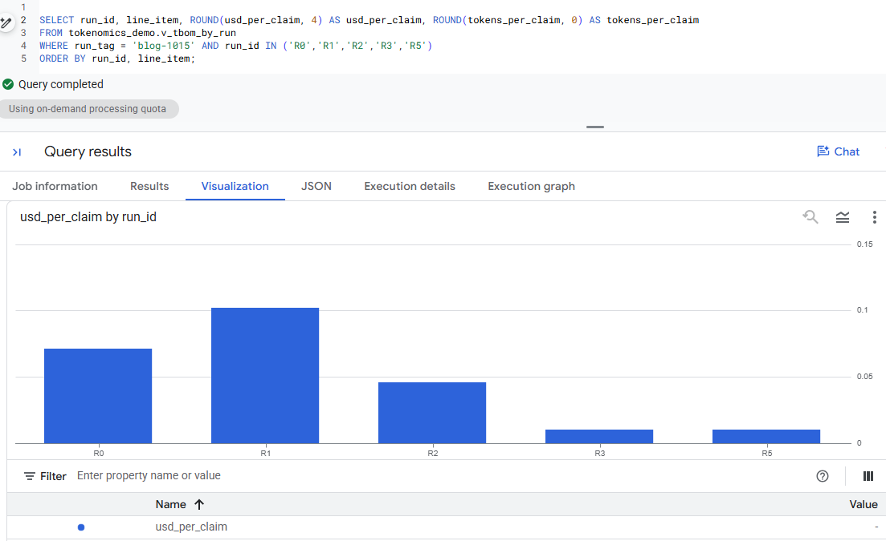
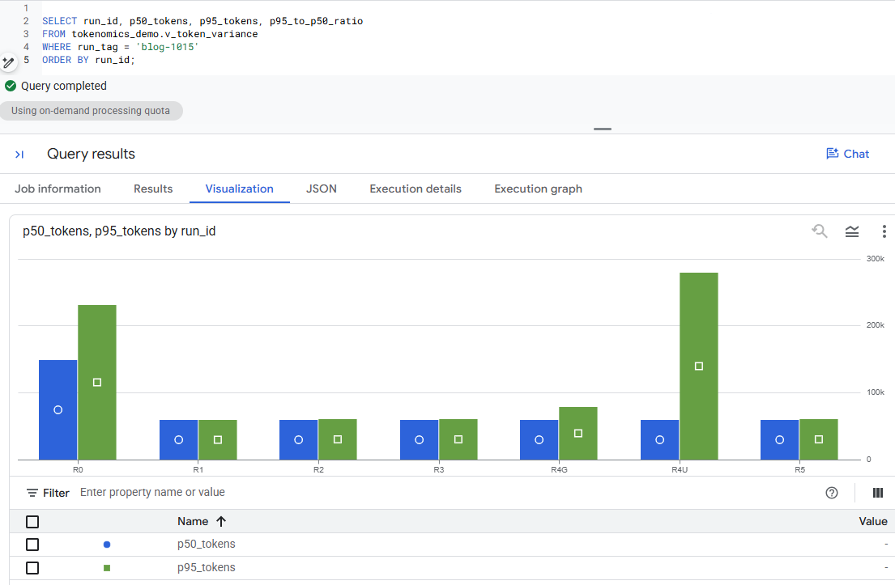
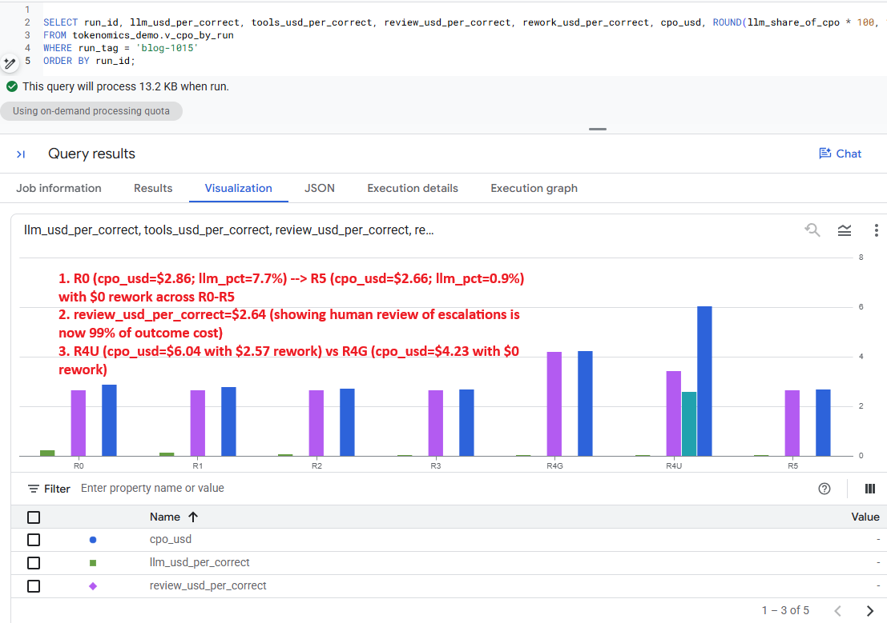
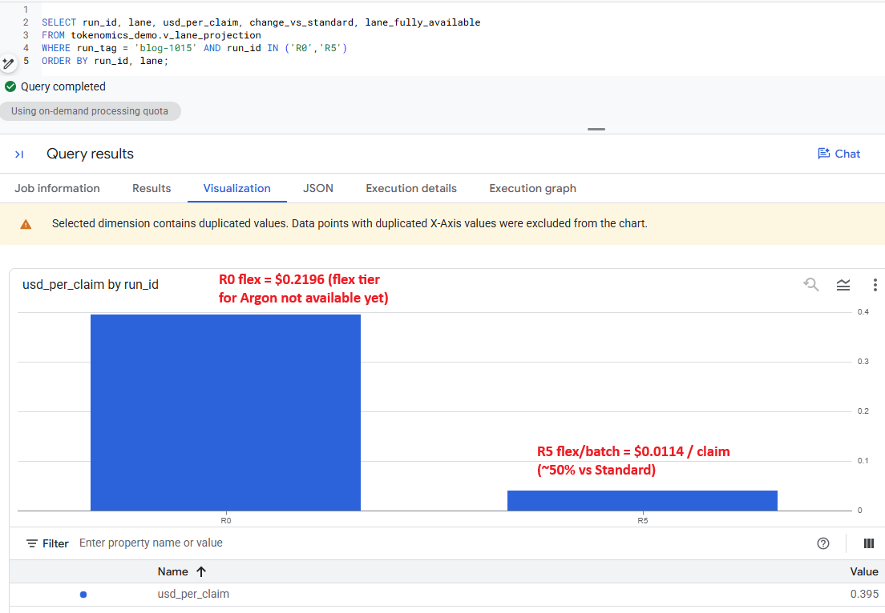
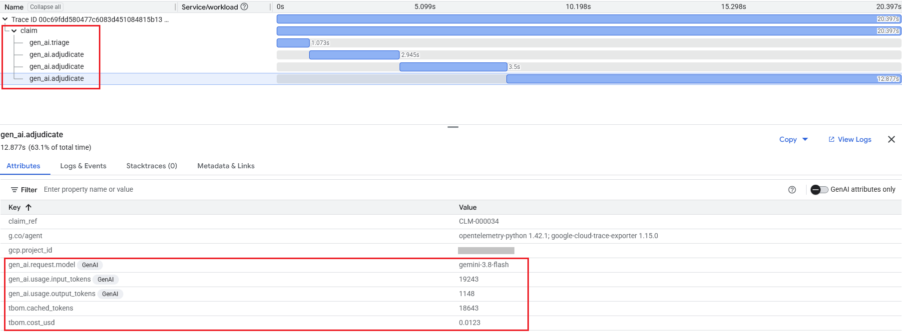
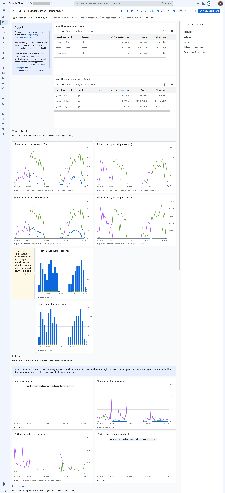
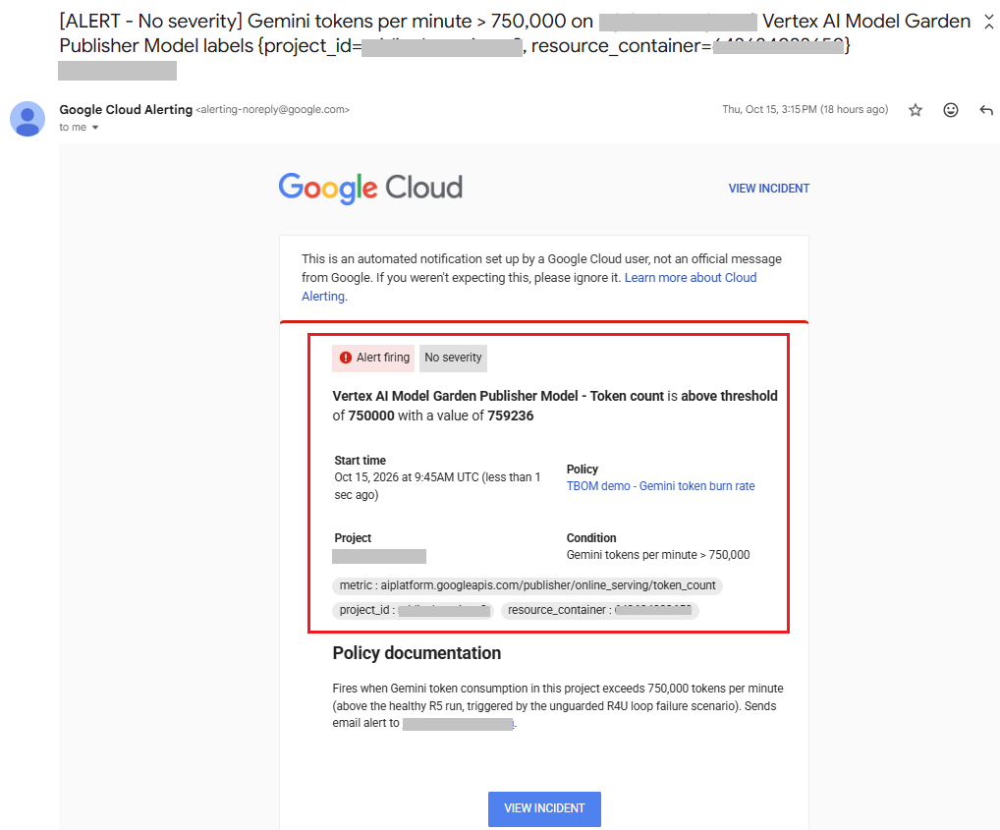
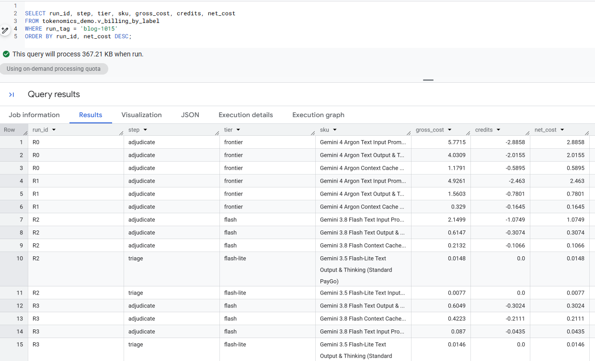

# 🧭 RUNBOOK: the TBOM demo & ADK Agent deployment, step by step

[](https://github.com/Rajdipc/tokenomics-paygo-demo)
[](https://medium.com/@rajdipch/81f6203fcbbc)
[](cymbal_claims_agent/)
[](run_experiment.py)
[](deploy/)

This runbook walks through both parts of the repository:
1. **Running the 7-design TBOM benchmark** ([`run_experiment.py`](run_experiment.py)) from Cloud Shell and analyzing the results in BigQuery, Cloud Monitoring, Cloud Trace, and Cloud Billing.
2. **Creating and deploying the production `R5` Google ADK agent** ([`cymbal_claims_agent/`](cymbal_claims_agent/)) to **Cloud Run** and **Gemini Platform Agent Runtime (Agent Engine)** using the scripts in [`deploy/`](deploy/).

Each step has a 📸 screenshot slot pointing at `docs/images/`. Drop your capture there and uncomment the image line below the slot.

> **Cost:** about \$26 at regular list price for the default runs in the author's run
> (\$23.17 for the waterfall, \$2.63 for R4U/R4G). Budget more headroom than that: model
> behaviour varies from run to run. Roughly half while the promotional credits apply (Gemini 4 Argon until 30 Nov 2026, Gemini 3.8 Flash until
> 31 Dec 2026). The script stops itself at `--max-usd`. Only the Gemini API calls, a few
> short-lived context caches and a small BigQuery dataset are billed.

> **Naming:** Gemini Platform is the product formerly called Vertex AI. Its documentation
> and some console pages still say "Agent Platform", and the API is still
> `aiplatform.googleapis.com`. All models used are generally available: `gemini-4-argon`,
> `gemini-3.8-flash` and `gemini-3.5-flash-lite`.

> **Before you publish screenshots:** redact project IDs, billing account IDs and e-mail
> addresses.

---

## 1. Pick or create a project

Console → project picker (top bar) → **New project**. Then check that billing is linked under
**Billing → Account management**.

A new project just for this demo keeps the billing breakdown clean.

## 2. Enable the APIs

Console → **APIs & Services → Library**. Search for each API and click **Enable**:

- **Agent Platform API** (`aiplatform.googleapis.com`), for Gemini on Gemini Platform
- **BigQuery API** (usually enabled already)
- **Cloud Trace API** (optional, for the trace screenshots)
- **Cloud Monitoring API** (for the token burn alert)

## 3. Guardrails first: a Cloud Billing Budget and a Cloud Monitoring Token-Burn Alert

Before calling the Gemini API, put two different guardrails in place—one for **monthly finance tracking** and one for **real-time operational runaway loops**:

| Guardrail | Service | Metric & Window | What It Catches | Does It Stop Traffic? |
|---|---|---|---|---|
| **Cloud Billing Budget** | Cloud Billing → Budgets & alerts | Cumulative **monthly USD spend** (`$`) across the billing period | Gradual monthly cost overruns or unexpected daily/weekly spend drift | **No** (sends email alerts at 50%, 90%, 100% actual & forecasted; updates every few hours) |
| **Token-Burn Rate Alert** | Cloud Monitoring → Alerting | Real-time **tokens per minute** (`token_count` over a 60-second rolling window) | Sudden runaway agent retry loops or traffic spikes (`R4U`) within 60–120 seconds | **No** (fires an immediate email/PagerDuty incident; your harness loop guards and `--max-usd` stop the process) |

### 3A. Create the Cloud Billing Budget (`c03_budget.png`)

1. Open [Cloud Billing → Budgets & alerts](https://console.cloud.google.com/billing) in the Google Cloud Console (select your billing account if prompted).
2. Click **+ CREATE BUDGET** in the top bar.
3. **Step 1 — Scope:**
   - **Name:** `TBOM Demo - Monthly Budget`
   - **Time range:** `Monthly`
   - **Projects:** Uncheck *All projects* and select only your demo project.
   - **Services:** Leave as *All services* (or select *Vertex AI / Gemini Platform* and *BigQuery*). Click **Next**.
4. **Step 2 — Amount:**
   - **Budget type:** `Specified amount`
   - **Target amount:** `$100.00` (the full experiment costs ~$19 at list price, or ~$10 after promotional credits). Click **Next**.
5. **Step 3 — Actions:**
   - Set **Percent of budget** threshold rules at **`50%`** (`$50`), **`90%`** (`$90`), and **`100%`** (`$100`) of **Actual** spend.
   - Click **Add threshold rule**, set **Trigger on** = **`Forecasted`** at **`100%`**.
   - Check **Email alerts to billing admins and users** (or link a Cloud Monitoring email channel).
6. Click **Finish**.

> 📸 **Screenshot:** Budget → `docs/images/c03_budget.png`


### 3B. Create the Cloud Monitoring Token-Burn Rate Alert (`c04_alert_policy.png`)

1. Open [Cloud Monitoring → Alerting](https://console.cloud.google.com/monitoring/alerting) in your project.
2. First, ensure your email notification channel exists: click **Edit notification channels** at the top → scroll to **Email** → click **Add New** → enter your email address (e.g., `your-email@domain.com`) and display name → click **Save**.
3. Go back to **Monitoring → Alerting** and click **+ CREATE POLICY**:
   - **Select a metric:** Click the metric dropdown, uncheck **Show only active resources & metrics** if you haven't run a Gemini call yet, and select **`Publisher Model`** → **` Online serving`** → **`Token count`** (`aiplatform.googleapis.com/publisher/online_serving/token_count`). Click **Apply**.
   - **Rolling window:** `1 min`
   - **Rolling window function:** `sum` (calculates tokens per minute).
   - **Time series aggregation:** `sum`, leaving **Time series group by** empty (sums input + output + thinking tokens across all models in the project). Click **Next**.
4. **Configure alert trigger:**
   - **Condition types:** `Threshold`
   - **Alert trigger:** `Any time series violates`
   - **Threshold position:** `Above threshold`
   - **Threshold value:** `750000` (750,000 tokens/minute—about 1.25× the healthy `R5` peak, so normal `R5` traffic stays green while an unguarded runaway burst triggers the alert).
   - **Condition name:** `Gemini token burn rate > 750k tokens/min`. Click **Next**.
5. **Configure notifications and finalize:**
   - Select your **Email** notification channel under **Notification Channels**.
   - Set **Incident autoclose duration** to `30 min`.
   - Name the alert policy **`TBOM demo - Gemini token burn rate`** and click **Create Policy**.

> 📸 **Screenshot:** Alert policy → `docs/images/c04_alert_policy.png`


## 4. (Recommended) Turn on the Cloud Billing export to BigQuery

Billing data arrives with a delay, so do this before the run.

1. **BigQuery** → in Explorer, click ⋮ next to your project → **Create dataset**. Use ID
   `billing_export` and location **US (multi-region)**.
2. Console → **Billing → Billing export → BigQuery export → Detailed usage cost →
   Edit settings**. Choose your project and the `billing_export` dataset, then **Save**.

The export table (`gcp_billing_export_resource_v1_…`) appears after the first export, which
can take a few hours.

> 📸 **Screenshot:** Billing export → `docs/images/c05_billing_export.png`


You need a billing role on the billing account for this. If you don't have one, skip steps 4
and 10; the post then uses the script's own list-price estimates.

## 5. Run the experiment & deploy the Google ADK agent from Cloud Shell

Open **Cloud Shell** (the `>_` icon in the console top bar). Then clone the repo:

```bash
git clone https://github.com/Rajdipc/tokenomics-paygo-demo.git
cd tokenomics-paygo-demo
pip install -U -r requirements.txt
cp .env.example .env && nano .env      # set GOOGLE_CLOUD_PROJECT and TBOM_RUN_TAG
source .env
```

### 5A. Run the 7-design TBOM experiment (`R0` through `R5`, `R4U`, `R4G`)

```bash
# The waterfall: the same 50 claims through R0, R1, R2, R3 and R5 (30-60 minutes)
python run_experiment.py --runs R0 R1 R2 R3 R5 --n 50 --trace

# The loop-guard experiment: a flaky dependency, without and with guards
python run_experiment.py --runs R4U R4G --n 40 --trace
```

Every Gemini call carries request labels:

| Label | Value |
|---|---|
| `app` | `cymbal-claims` |
| `experiment` | `tbom` |
| `run` | `r0`…`r5` |
| `run_tag` | your tag |
| `step` | `triage` / `adjudicate` / `review` |
| `tier` | `frontier` / `flash` / `flash-lite` |

The labels end up in Cloud Billing. The results land in `results/<run_tag>/` as three files:
`calls.jsonl`, `claims.jsonl` and `runs.jsonl`.

> 📸 **Screenshot:** Run summary in Cloud Shell → `docs/images/s02_run_r0_r5.png`


To get the files to your computer for step 6, use the Cloud Shell ⋮ menu → **Download**. Enter
each file path, for example `tokenomics-paygo-demo/results/<run_tag>/calls.jsonl`.

### 5B. Inspect, test, and deploy the production `R5` Google ADK agent (`cymbal_claims_agent/`)

The production `R5` architecture is packaged as a standard **Google ADK 2.x** agent in [`cymbal_claims_agent/`](cymbal_claims_agent/):
- [`cymbal_claims_agent/agent.py`](cymbal_claims_agent/agent.py): Defines `root_agent` (an ADK `Workflow` chaining `triage_agent` on `gemini-3.5-flash-lite` and `adjudicator_agent` on `gemini-3.8-flash` with static-first `SKILL.md` + `policy_handbook.md` prefix) and `app` (`google.adk.apps.App`).
- [`cymbal_claims_agent/tbom.py`](cymbal_claims_agent/tbom.py): Defines `TBOMLedgerPlugin(BasePlugin)`, which attaches Cloud Billing labels before every model turn (`before_model_callback`) and records the 6-item TBOM breakdown and list-price USD cost after every turn (`after_model_callback`) into `session.state["tbom_calls"]`.
- [`cymbal_claims_agent/tools.py`](cymbal_claims_agent/tools.py): Defines the 4 compact ADK tool functions (`get_policy`, `get_claims_history`, `screen_fraud`, `submit_decision`) with deterministic policy ID normalization (`003009` → `POL-003009`) and the `retry_budget=1` circuit breaker.
- [`cymbal_claims_agent/fast_api_app.py`](cymbal_claims_agent/fast_api_app.py): FastAPI server exposing `GET /api/health`, `POST /api/adjudicate`, Agent Runtime (`reasoning_engine`) endpoints, and the ADK web UI.

```bash
# 1. Enable APIs and create the least-privilege Service Account
bash deploy/01_enable_apis.sh
bash deploy/02_service_account_iam.sh

# 2. Smoke-test the ADK agent locally in-process (or run `adk web . --port 8080`)
python deploy/05_test_deployed_agent.py --claim-ref CLM-000001

# 3. Option A — Deploy to Cloud Run (builds container via Cloud Build & deploys service)
bash deploy/03_deploy_cloud_run.sh
SERVICE_URL="$(gcloud run services describe cymbal-claims-tbom-agent \
  --region="${DEPLOY_REGION:-us-central1}" --project="$GOOGLE_CLOUD_PROJECT" --format='value(status.url)')"
python deploy/05_test_deployed_agent.py --cloud-run-url "$SERVICE_URL" --claim-ref CLM-000001

# 4. Option B — Deploy to Gemini Platform Agent Runtime (managed ReasoningEngine)
python deploy/04_deploy_agent_runtime.py
python deploy/05_test_deployed_agent.py --agent-runtime-id auto --claim-ref CLM-000001
```

## 6. Load the results into BigQuery (console upload)

1. **BigQuery** → Explorer → ⋮ next to your project → **Create dataset**. Use ID
   `tokenomics_demo` and location **US (multi-region)**, the same as `billing_export`.
2. Next to `tokenomics_demo`, click ⋮ → **Create table**:
   - **Create table from:** Upload. Select `calls.jsonl`. **File format:** JSONL.
   - **Table:** `calls`.
   - **Schema:** turn on **Edit as text** and paste the contents of `sql/schemas/calls.json`.
   - **Create table.**
3. Repeat for `claims.jsonl` → table `claims` (schema `sql/schemas/claims.json`), and
   `runs.jsonl` → table `runs` (schema `sql/schemas/runs.json`).

> 📸 **Screenshot:** Create table from upload → `docs/images/c06_upload_table.png`


If you run more experiments later, upload again with **Advanced options → Write preference:
Append to table**.

> **Optional shortcut from Cloud Shell**, instead of downloading and uploading:
> ```bash
> for t in calls claims runs; do bq load --source_format=NEWLINE_DELIMITED_JSON \
>   tokenomics_demo.$t results/$TBOM_RUN_TAG/$t.jsonl sql/schemas/$t.json; done
> ```

## 7. Create the reference tables and the views (BigQuery Studio)

1. BigQuery Studio → **+** (new query tab).
2. Paste the contents of `sql/00_reference_tables.sql` and click **Run**. This creates the
   `pricing` and `cpo_params` tables.
3. Do the same, one file at a time, for `01_run_summary.sql` through `06_loop_guard.sql`. Each
   one creates a view.

> 📸 **Screenshot:** Running a view in BigQuery Studio → `docs/images/c07_bq_studio_view.png`
<!--  -->

## 8. Build the charts (BigQuery Studio → Visualization tab)

For each query: paste it, **Run**, then open the **Visualization** tab under the results.
Choose the chart type and fields as listed. Export or screenshot each chart for the post.

**Waterfall (`s05_bq_waterfall.png`):** bar chart; X `run_label`; Y `cost_per_claim_usd`.

```sql
SELECT run_label, cost_per_claim_usd, accuracy FROM tokenomics_demo.v_run_summary
WHERE run_id IN ('R0','R1','R2','R3','R5') ORDER BY run_order;
```



**Token Bill of Materials (`s06_bq_tbom.png`):** stacked bar; X `run_id`; series
`line_item`; Y `usd_per_claim`. Run it again with `tokens_per_claim` as Y.

```sql
SELECT run_id, line_item, usd_per_claim, tokens_per_claim FROM tokenomics_demo.v_tbom_by_run
WHERE run_id IN ('R0','R1','R2','R3','R5') ORDER BY run_id, line_item;
```



**Variance (`s07_bq_variance.png`):** bar chart; X `run_id`; Y `p50_tokens` and `p95_tokens`.

```sql
SELECT run_id, p50_tokens, p95_tokens, p95_to_p50_ratio FROM tokenomics_demo.v_token_variance ORDER BY run_id;
```



**Cost per outcome (`s08_bq_cpo.png`):** stacked bar; X `run_id`; Y the four
`*_per_correct` columns.

```sql
SELECT run_id, llm_usd_per_correct, tools_usd_per_correct, review_usd_per_correct, rework_usd_per_correct, cpo_usd
FROM tokenomics_demo.v_cpo_by_run ORDER BY run_id;
```



**Consumption lanes (`s09_bq_lanes.png`):** grouped bar; X `run_id`; series `lane`; Y
`usd_per_claim`.

```sql
SELECT run_id, lane, usd_per_claim, change_vs_standard FROM tokenomics_demo.v_lane_projection
WHERE run_id IN ('R0','R5') ORDER BY run_id, lane;
```



**Loop guard (`s10_loop_guard.png`):** bar chart; X `run_id`; Y `avg_cost_usd` and
`max_llm_calls`.

```sql
SELECT run_id, avg_llm_calls, max_llm_calls, avg_cost_usd, max_cost_usd, accuracy
FROM tokenomics_demo.v_loop_guard WHERE fault_injected ORDER BY run_id;
```

**PT sizing what-if:** paste `sql/09_pt_what_if.sql` and Run. Bar chart; X
`sizing_percentile`; Y `share_on_pt`. Nothing is purchased.

**Alternative:** **BigQuery data canvas** can do the same. Add a view as a node, then add a
visualization node (bar, line, pie, scatter or heat map). It can export charts as PNG. Looker
Studio is optional and not needed for this demo.

> 📸 **Screenshot:** Visualization tab → `docs/images/c08_visualization_tab.png`
<!--  -->

## 9. Evidence in Cloud Trace, Monitoring and Agent Platform

- **Trace:** Console → **Observability → Trace explorer**, filtered on service
  `tbom-claims-demo`. Open one R0 claim and one R5 claim. Each model-call span has
  `gen_ai.usage.*` and `tbom.cost_usd` attributes. Save as `s03_trace.png`.

  

- **Model observability:** Console → **Monitoring → Dashboards → Vertex AI Model Garden Monitoring** (`https://console.cloud.google.com/monitoring/dashboards/integration/vertex_ai.vertex-ai-model-garden`, or **Monitoring → Metrics explorer** on `aiplatform.googleapis.com/publisher/online_serving/token_count` grouped by `model_user_id`). Save as `s04_model_observability.png`.

  

- **Alert (`R4U` Failure Scenario Verification):** Console → **Monitoring → Alerting** → open the **`TBOM demo - Gemini token burn rate`** policy and set the time range to your `R5` / `R4U` / `R4G` run window. Save the condition chart as `s11_alert.png`.
  - In the blog's run, healthy `R5` peaked at **645,546 tokens/min** (safely below the **750,000 tokens/min** threshold).
  - When `R4U` hit the 20% upstream timeout fault on `screen_fraud` without loop guards, the 15-call retry loops (`SAFETY_CAP_REACHED`) drove the token rate above 750,000 tokens/min for four consecutive minutes—peaking at **905,391 tokens/min**—and fired the email alert.
  - When `R4G` ran next with `max_same_call=2` + prompt fallback, the token rate stayed below the threshold (peaking at **726,753 tokens/min**) and resolved 100% of claims accurately.

  

## 10. The real invoice by label (once the billing export has data)

1. Open `sql/07_billing_by_label.sql`. Replace the `billing_export.gcp_billing_export_resource_v1_XXXXXX…`
   table name with yours (you can see it in BigQuery under `billing_export`). Run it.
2. Run `sql/08_estimate_vs_invoice.sql`.
3. Query and screenshot `s13_billing_labels.png`:

```sql
SELECT run_id, step, tier, sku, gross_cost, credits, net_cost FROM tokenomics_demo.v_billing_by_label
WHERE run_tag = 'YOUR_RUN_TAG' ORDER BY run_id, net_cost DESC;
```



Explicit-cache storage has no request labels, so it shows up as its own SKU with an empty
`run`.

## 11. Optional: put Apigee in front (not part of the default run; deploys a gateway)

This step is only described in the blog, not run. If you do run it, it creates billable
resources, so check Apigee pricing (Evaluation or Pay-as-you-go) first.

1. Console → **Apigee** → follow the provisioning wizard (Evaluation or Pay-as-you-go).
2. **Proxy development → API proxies → Create**: a proxy whose target is the Gemini endpoint.
3. Attach **LLMTokenQuota** (token budget per app) and **PromptTokenLimit** (prompt-burst
   protection). Add **SemanticCacheLookup/Populate** only for traffic that genuinely repeats.
4. Send R5's traffic through the proxy, then watch **Analytics → API metrics** for usage by
   app and for 429s once the quota runs out.

Screenshots: `docs/images/c09_apigee_policies.png` and `docs/images/s14_apigee_analytics.png`.

## 12. Clean up / Destroy this deployment

To leave **zero ongoing storage, container, agent runtime, monitoring, or artifact footprint**, run the automated teardown script (`deploy/99_destroy.sh`) or follow the Console teardown below.

### Option A: Automated 1-Command CLI Teardown (`deploy/99_destroy.sh`)

```bash
# Deletes Cloud Run service, Artifact Registry repo, Agent Runtime (ReasoningEngine),
# GCS staging bucket, BigQuery dataset, Cloud Monitoring alert & channel, and Gemini context caches:
bash deploy/99_destroy.sh
```

Or run individual commands manually:

```bash
source .env

# 1. Delete Cloud Run service & Artifact Registry repository (if deployed)
gcloud run services delete cymbal-claims-tbom-agent --region="${DEPLOY_REGION:-us-central1}" --project="$GOOGLE_CLOUD_PROJECT" --quiet
gcloud artifacts repositories delete cymbal-claims-tbom --location="${DEPLOY_REGION:-us-central1}" --project="$GOOGLE_CLOUD_PROJECT" --quiet

# 2. Delete the BigQuery dataset (tables + views)
bq --project_id="$GOOGLE_CLOUD_PROJECT" rm -r -f -d "$GOOGLE_CLOUD_PROJECT:tokenomics_demo"

# 3. Delete the Cloud Monitoring token-burn alert policy and email notification channel
for policy in $(gcloud alpha monitoring policies list --project="$GOOGLE_CLOUD_PROJECT" \
  --filter='displayName:"TBOM"' --format='value(name)'); do
  gcloud alpha monitoring policies delete "$policy" --project="$GOOGLE_CLOUD_PROJECT" --quiet
done

for channel in $(gcloud beta monitoring channels list --project="$GOOGLE_CLOUD_PROJECT" \
  --filter='displayName:"TBOM"' --format='value(name)'); do
  gcloud beta monitoring channels delete "$channel" --project="$GOOGLE_CLOUD_PROJECT" --quiet
done

# 4. Verify no active Gemini context caches remain (run_experiment.py deletes them at exit; TTL is 1h)
python -c "
import os
from google import genai
client = genai.Client(vertexai=True, project=os.environ['GOOGLE_CLOUD_PROJECT'], location=os.environ.get('GOOGLE_CLOUD_LOCATION','global'))
for c in client.caches.list():
    if 'tbom' in (c.display_name or ''):
        print('Deleting cache:', c.name)
        client.caches.delete(name=c.name)
"

# 5. Remove local result logs
rm -rf results/ deployment_metadata.json
```

### Option B: Cloud Console UI Teardown

- **Cloud Run** (if deployed in Step 5B): **Cloud Run → Services** → select `cymbal-claims-tbom-agent` → **Delete**. Then open **Artifact Registry → Repositories** → delete `cymbal-claims-tbom`.
- **Agent Runtime** (if deployed in Step 5B): **Agent Platform (Gemini Platform) → Agent Engine / Reasoning Engines** → delete `cymbal-claims-tbom-agent`, and delete the `<PROJECT_ID>-tbom-agent-staging` bucket in **Cloud Storage**.
- **BigQuery:** **BigQuery → Studio** → click `⋮` next to `tokenomics_demo` → **Delete** → type `delete` to confirm. Keep `billing_export` if you use it elsewhere.
- **Monitoring → Alerting:** **Monitoring → Alerting → Policies** → click `⋮` next to `TBOM demo - Gemini token burn rate` → **Delete**. Under **Edit notification channels**, remove the demo email channel if no longer needed.
- **Billing → Budgets & alerts:** Select your demo budget → click **Delete** in the top bar.
- **Context caches:** `run_experiment.py` deletes its explicit cache in a `finally:` block at the end of `R3` and `R5`, and any orphaned cache expires automatically after its 1-hour TTL.
- **Apigee** (only if you ran step 11): Delete the API proxy and the evaluation organization/environment.

---

## 📸 Screenshot list

| File | Step | What |
|---|---|---|
| `docs/images/c03_budget.png` | 3 | Budget with thresholds |
| `docs/images/c04_alert_policy.png` | 3 | Token count alert policy |
| `docs/images/c05_billing_export.png` | 4 | Detailed usage cost export settings |
| `docs/images/c06_upload_table.png` | 6 | Create table from JSONL upload, schema as text |
| `docs/images/c07_bq_studio_view.png` | 7 | A view created in BigQuery Studio |
| `docs/images/c08_visualization_tab.png` | 8 | Visualization tab configured |
| `docs/images/s02_run_r0_r5.png` | 5 | Cloud Shell run summary |
| `docs/images/s03_trace.png` | 9 | Trace explorer, one claim |
| `docs/images/s04_model_observability.png` | 9 | Model observability dashboard |
| `docs/images/s05`–`s10_*.png` | 8 | The BigQuery charts used in the post |
| `docs/images/s11_alert.png` | 9 | Alert incident |
| `docs/images/s13_billing_labels.png` | 10 | Invoice by label |
| `docs/images/c09_apigee_policies.png` | 11 (optional) | Apigee proxy with LLMTokenQuota + PromptTokenLimit |
| `docs/images/s14_apigee_analytics.png` | 11 (optional) | Apigee analytics by app, 429s after the quota runs out |
