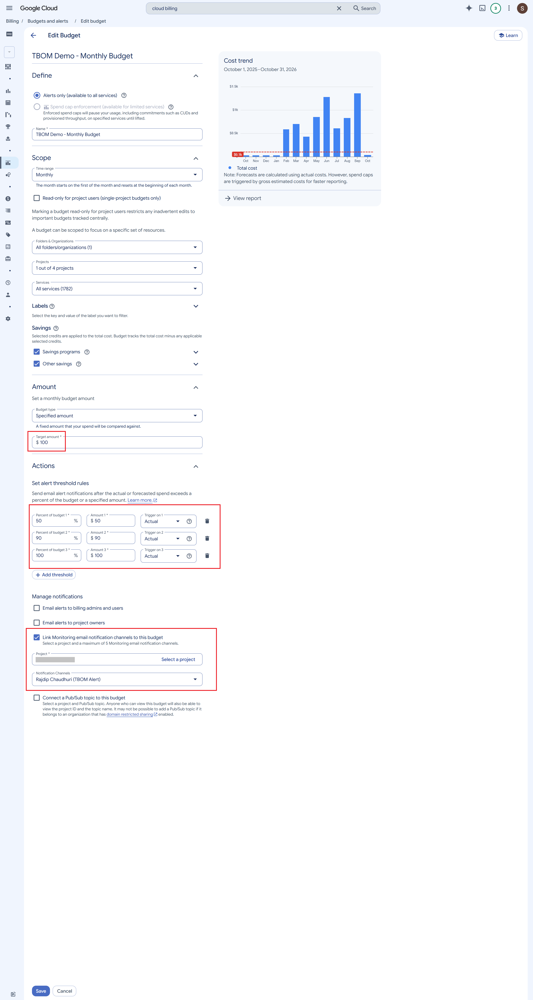
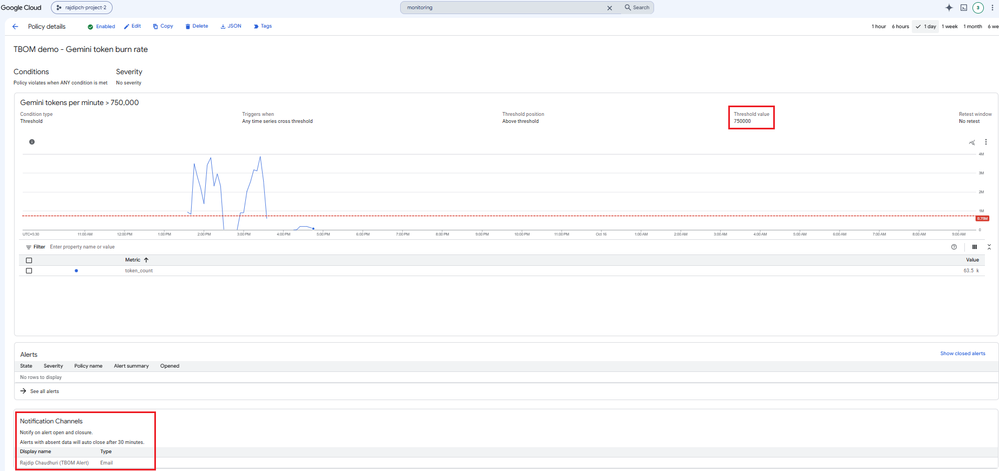
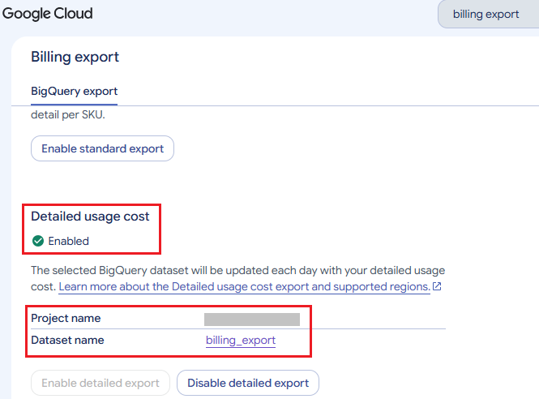
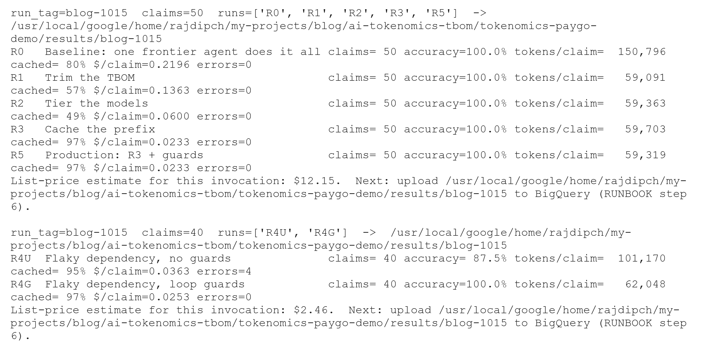
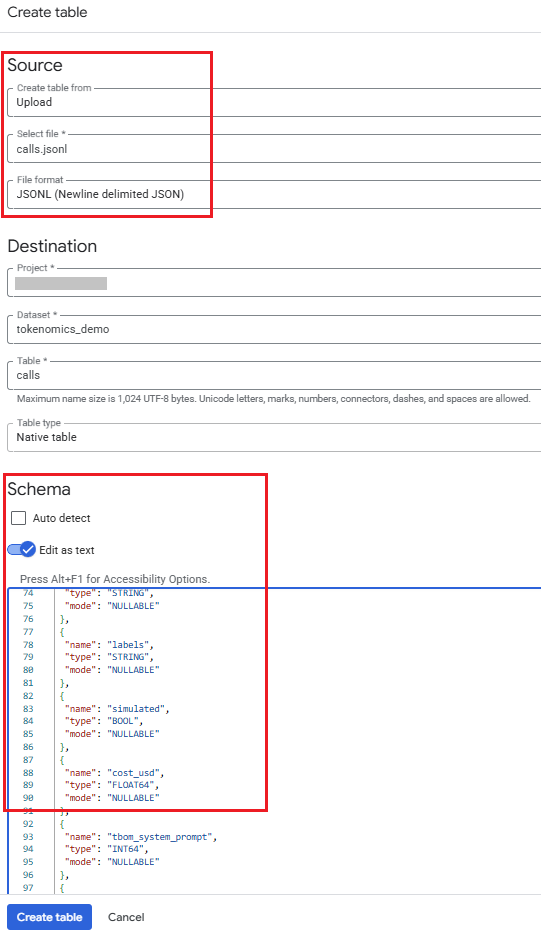

# 🧭 RUNBOOK: the TBOM demo, step by step in the Cloud Console

[](https://github.com/Rajdipc/tokenomics-paygo-demo)
[](#)
[](run_experiment.py)
[](#)

There is **one** script, [`run_experiment.py`](run_experiment.py), which you run once from Cloud Shell in step 5. Everything else happens in the Google Cloud console. Each step has a 📸 screenshot slot pointing at `docs/images/`. Drop your capture there and uncomment the image line below the slot.

> **Cost:** about \$58 at regular list price for the default runs, roughly half while the
> promotional credits apply (Gemini 4 Argon until 30 Nov 2026, Gemini 3.8 Flash until
> 31 Dec 2026). The script stops itself at `--max-usd`. Only the Gemini API calls, a few
> short-lived context caches and a small BigQuery dataset are billed.

> **Naming:** Gemini Platform is the product formerly called Vertex AI. Its documentation
> and some console pages still say "Agent Platform", and the API is still
> `aiplatform.googleapis.com`. All models used are generally available: `gemini-4-argon`,
> `gemini-3.8-flash` and `gemini-3.5-flash-lite`.

> **Before you publish screenshots:** redact project IDs, billing account IDs and e-mail
> addresses.

---

## 1. Pick or create a project

Console → project picker (top bar) → **New project**. Then check that billing is linked under
**Billing → Account management**.

A new project just for this demo keeps the billing breakdown clean.

> 📸 **Screenshot:** Create project → `docs/images/c01_create_project.png`
<!--  -->

## 2. Enable the APIs

Console → **APIs & Services → Library**. Search for each API and click **Enable**:

- **Agent Platform API** (`aiplatform.googleapis.com`), for Gemini on Gemini Platform
- **BigQuery API** (usually enabled already)
- **Cloud Trace API** (optional, for the trace screenshots)
- **Cloud Monitoring API** (for the token burn alert)

> 📸 **Screenshot:** Enable the Agent Platform API → `docs/images/c02_enable_api.png`
<!--  -->

## 3. Guardrails first: a budget and a token alert

**Budget:**

1. Console → **Billing → Budgets & alerts → Create budget**.
2. **Scope:** this project.
3. **Amount:** for example \$100.
4. **Thresholds:** 50%, 90% and 100%. Add 100% of *forecasted* spend as well.
5. **Finish.**

Budgets send alerts; they don't cap spend. The script's `--max-usd` and the agent's loop
guards are what actually stop spending.

> 📸 **Screenshot:** Budget → `docs/images/c03_budget.png`
<!--  -->

**Token burn alert:**

1. Console → **Monitoring → Alerting → Create policy → Select a metric**.
2. Pick resource **Publisher Model**, then metric **Token count**
   (`aiplatform.googleapis.com/publisher/online_serving/token_count`).
3. **Rolling window:** 1 min. **Window function:** sum. Across time series: sum.
4. **Threshold:** above 1,500,000 tokens per minute. Tune it to about 1.5× the peak you see
   during the R5 run.
5. Add a notification channel (e-mail), name the policy `TBOM token burn`, then **Create**.

The metric shows up in the picker only after the first Gemini call. You can create this
policy after step 5 if needed.

> 📸 **Screenshot:** Alert policy → `docs/images/c04_alert_policy.png`
<!--  -->

## 4. (Recommended) Turn on the Cloud Billing export to BigQuery

Billing data arrives with a delay, so do this before the run.

1. **BigQuery** → in Explorer, click ⋮ next to your project → **Create dataset**. Use ID
   `billing_export` and location **US (multi-region)**.
2. Console → **Billing → Billing export → BigQuery export → Detailed usage cost →
   Edit settings**. Choose your project and the `billing_export` dataset, then **Save**.

The export table (`gcp_billing_export_resource_v1_…`) appears after the first export, which
can take a few hours.

> 📸 **Screenshot:** Billing export → `docs/images/c05_billing_export.png`
<!--  -->

You need a billing role on the billing account for this. If you don't have one, skip steps 4
and 10; the post then uses the script's own list-price estimates.

## 5. Run the experiment from Cloud Shell (the only command-line step)

Open **Cloud Shell** (the `>_` icon in the console top bar). Then clone the repo:

```bash
git clone https://github.com/Rajdipc/tokenomics-paygo-demo.git
cd tokenomics-paygo-demo
pip install -r requirements.txt
cp .env.example .env && nano .env      # set GOOGLE_CLOUD_PROJECT and TBOM_RUN_TAG
source .env

# The waterfall: the same 50 claims through R0, R1, R2, R3 and R5 (30-60 minutes)
python run_experiment.py --runs R0 R1 R2 R3 R5 --n 50 --trace

# The loop-guard experiment: a flaky dependency, without and with guards
python run_experiment.py --runs R4U R4G --n 40 --trace
```

Every Gemini call carries request labels:

| Label | Value |
|---|---|
| `app` | `cymbal-claims` |
| `experiment` | `tbom` |
| `run` | `r0`…`r5` |
| `run_tag` | your tag |
| `step` | `triage` / `adjudicate` / `review` |
| `tier` | `frontier` / `flash` / `flash-lite` |

The labels end up in Cloud Billing. The results land in `results/<run_tag>/` as three files:
`calls.jsonl`, `claims.jsonl` and `runs.jsonl`.

> 📸 **Screenshot:** Run summary in Cloud Shell → `docs/images/s02_run_r0_r5.png`
<!--  -->

To get the files to your computer for step 6, use the Cloud Shell ⋮ menu → **Download**. Enter
each file path, for example `tokenomics-paygo-demo/results/<run_tag>/calls.jsonl`.

## 6. Load the results into BigQuery (console upload)

1. **BigQuery** → Explorer → ⋮ next to your project → **Create dataset**. Use ID
   `tokenomics_demo` and location **US (multi-region)**, the same as `billing_export`.
2. Next to `tokenomics_demo`, click ⋮ → **Create table**:
   - **Create table from:** Upload. Select `calls.jsonl`. **File format:** JSONL.
   - **Table:** `calls`.
   - **Schema:** turn on **Edit as text** and paste the contents of `sql/schemas/calls.json`.
   - **Create table.**
3. Repeat for `claims.jsonl` → table `claims` (schema `sql/schemas/claims.json`), and
   `runs.jsonl` → table `runs` (schema `sql/schemas/runs.json`).

> 📸 **Screenshot:** Create table from upload → `docs/images/c06_upload_table.png`
<!--  -->

If you run more experiments later, upload again with **Advanced options → Write preference:
Append to table**.

> **Optional shortcut from Cloud Shell**, instead of downloading and uploading:
> ```bash
> for t in calls claims runs; do bq load --source_format=NEWLINE_DELIMITED_JSON \
>   tokenomics_demo.$t results/$TBOM_RUN_TAG/$t.jsonl sql/schemas/$t.json; done
> ```

## 7. Create the reference tables and the views (BigQuery Studio)

1. BigQuery Studio → **+** (new query tab).
2. Paste the contents of `sql/00_reference_tables.sql` and click **Run**. This creates the
   `pricing` and `cpo_params` tables.
3. Do the same, one file at a time, for `01_run_summary.sql` through `06_loop_guard.sql`. Each
   one creates a view.

> 📸 **Screenshot:** Running a view in BigQuery Studio → `docs/images/c07_bq_studio_view.png`
<!--  -->

## 8. Build the charts (BigQuery Studio → Visualization tab)

For each query: paste it, **Run**, then open the **Visualization** tab under the results.
Choose the chart type and fields as listed. Export or screenshot each chart for the post.

**Waterfall (`s05_bq_waterfall.png`):** bar chart; X `run_label`; Y `cost_per_claim_usd`.

```sql
SELECT run_label, cost_per_claim_usd, accuracy FROM tokenomics_demo.v_run_summary
WHERE run_id IN ('R0','R1','R2','R3','R5') ORDER BY run_order;
```

**Token Bill of Materials (`s06_bq_tbom.png`):** stacked bar; X `run_id`; series
`line_item`; Y `usd_per_claim`. Run it again with `tokens_per_claim` as Y.

```sql
SELECT run_id, line_item, usd_per_claim, tokens_per_claim FROM tokenomics_demo.v_tbom_by_run
WHERE run_id IN ('R0','R1','R2','R3','R5') ORDER BY run_id, line_item;
```

**Variance (`s07_bq_variance.png`):** bar chart; X `run_id`; Y `p50_tokens` and `p95_tokens`.

```sql
SELECT run_id, p50_tokens, p95_tokens, p95_to_p50_ratio FROM tokenomics_demo.v_token_variance ORDER BY run_id;
```

**Cost per outcome (`s08_bq_cpo.png`):** stacked bar; X `run_id`; Y the four
`*_per_correct` columns.

```sql
SELECT run_id, llm_usd_per_correct, tools_usd_per_correct, review_usd_per_correct, rework_usd_per_correct, cpo_usd
FROM tokenomics_demo.v_cpo_by_run ORDER BY run_id;
```

**Consumption lanes (`s09_bq_lanes.png`):** grouped bar; X `run_id`; series `lane`; Y
`usd_per_claim`.

```sql
SELECT run_id, lane, usd_per_claim, change_vs_standard FROM tokenomics_demo.v_lane_projection
WHERE run_id IN ('R0','R5') ORDER BY run_id, lane;
```

**Loop guard (`s10_loop_guard.png`):** bar chart; X `run_id`; Y `avg_cost_usd` and
`max_llm_calls`.

```sql
SELECT run_id, avg_llm_calls, max_llm_calls, avg_cost_usd, max_cost_usd, accuracy
FROM tokenomics_demo.v_loop_guard WHERE fault_injected ORDER BY run_id;
```

**PT sizing what-if:** paste `sql/09_pt_what_if.sql` and Run. Bar chart; X
`sizing_percentile`; Y `share_on_pt`. Nothing is purchased.

**Alternative:** **BigQuery data canvas** can do the same. Add a view as a node, then add a
visualization node (bar, line, pie, scatter or heat map). It can export charts as PNG. Looker
Studio is optional and not needed for this demo.

> 📸 **Screenshot:** Visualization tab → `docs/images/c08_visualization_tab.png`
<!--  -->

## 9. Evidence in Cloud Trace, Monitoring and Agent Platform

- **Trace:** Console → **Observability → Trace explorer**, filtered on service
  `tbom-claims-demo`. Open one R0 claim and one R5 claim. Each model-call span has
  `gen_ai.usage.*` and `tbom.cost_usd` attributes. Save as `s03_trace.png`.
- **Model observability:** Console → **Agent Platform (Gemini Platform) → Dashboard → Model
  observability → Show all metrics**. Save as `s04_model_observability.png`.
- **Alert:** Console → **Monitoring → Alerting → Incidents**. The token burn alert should fire
  during R4U. Save as `s11_alert.png`. If it doesn't fire, lower the threshold.

## 10. The real invoice by label (once the billing export has data)

1. Open `sql/07_billing_by_label.sql`. Replace the `billing_export.gcp_billing_export_resource_v1_XXXXXX…`
   table name with yours (you can see it in BigQuery under `billing_export`). Run it.
2. Run `sql/08_estimate_vs_invoice.sql`.
3. Query and screenshot `s13_billing_labels.png`:

```sql
SELECT run_id, step, tier, sku, net_cost FROM tokenomics_demo.v_billing_by_label
WHERE run_tag = 'YOUR_RUN_TAG' ORDER BY run_id, net_cost DESC;
```

Explicit-cache storage has no request labels, so it shows up as its own SKU with an empty
`run`.

## 11. Optional: put Apigee in front (not part of the default run; deploys a gateway)

This step is only described in the blog, not run. If you do run it, it creates billable
resources, so check Apigee pricing (Evaluation or Pay-as-you-go) first.

1. Console → **Apigee** → follow the provisioning wizard (Evaluation or Pay-as-you-go).
2. **Proxy development → API proxies → Create**: a proxy whose target is the Gemini endpoint.
3. Attach **LLMTokenQuota** (token budget per app) and **PromptTokenLimit** (prompt-burst
   protection). Add **SemanticCacheLookup/Populate** only for traffic that genuinely repeats.
4. Send R5's traffic through the proxy, then watch **Analytics → API metrics** for usage by
   app and for 429s once the quota runs out.

Screenshots: `docs/images/c09_apigee_policies.png` and `docs/images/s14_apigee_analytics.png`.

## 12. Clean up

- **BigQuery** → ⋮ next to `tokenomics_demo` → **Delete**. Keep `billing_export` if you use it
  elsewhere.
- **Monitoring → Alerting:** delete the `TBOM token burn` policy.
- **Billing → Budgets & alerts:** delete the demo budget.
- **Context caches:** the script deletes its caches at the end of each run, and any it misses
  expire after 1 hour.
- **Apigee** (only if you ran step 11): delete the proxy and the organization or environment.

---

## 📸 Screenshot list

| File | Step | What |
|---|---|---|
| `docs/images/c01_create_project.png` | 1 | New project |
| `docs/images/c02_enable_api.png` | 2 | Agent Platform API enabled |
| `docs/images/c03_budget.png` | 3 | Budget with thresholds |
| `docs/images/c04_alert_policy.png` | 3 | Token count alert policy |
| `docs/images/c05_billing_export.png` | 4 | Detailed usage cost export settings |
| `docs/images/c06_upload_table.png` | 6 | Create table from JSONL upload, schema as text |
| `docs/images/c07_bq_studio_view.png` | 7 | A view created in BigQuery Studio |
| `docs/images/c08_visualization_tab.png` | 8 | Visualization tab configured |
| `docs/images/s02_run_r0_r5.png` | 5 | Cloud Shell run summary |
| `docs/images/s03_trace.png` | 9 | Trace explorer, one claim |
| `docs/images/s04_model_observability.png` | 9 | Model observability dashboard |
| `docs/images/s05`–`s10_*.png` | 8 | The BigQuery charts used in the post |
| `docs/images/s11_alert.png` | 9 | Alert incident |
| `docs/images/s13_billing_labels.png` | 10 | Invoice by label |
| `docs/images/c09_apigee_policies.png` | 11 (optional) | Apigee proxy with LLMTokenQuota + PromptTokenLimit |
| `docs/images/s14_apigee_analytics.png` | 11 (optional) | Apigee analytics by app, 429s after the quota runs out |
